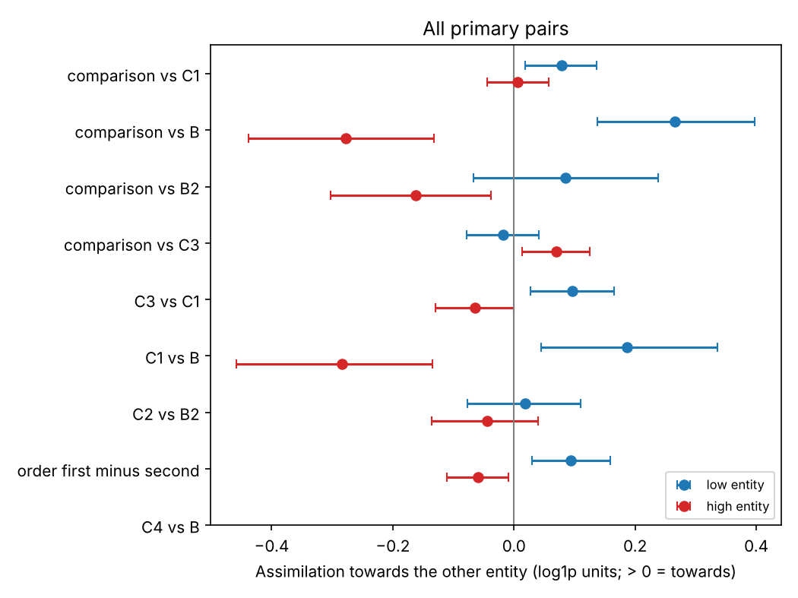
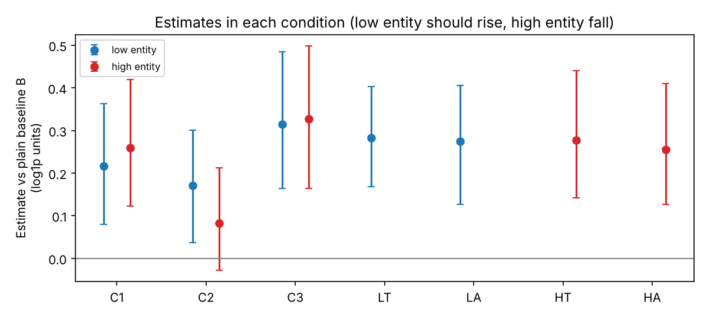
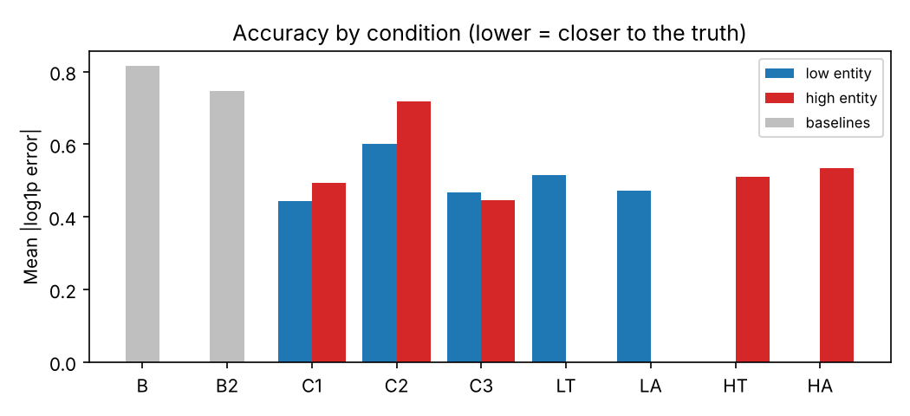
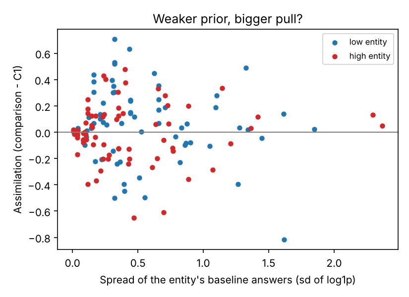
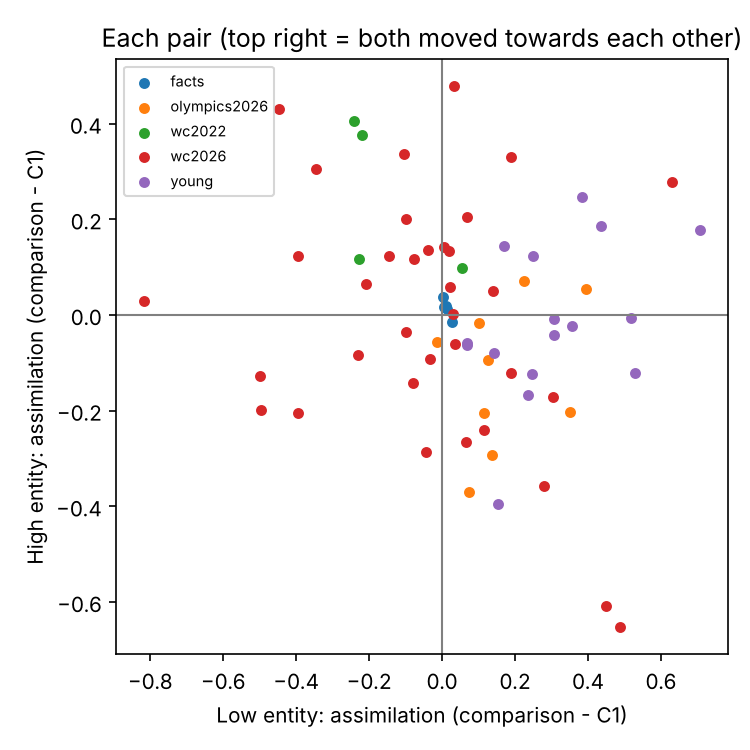

# Bidirectional anchoring: qwen3-32b (thinking off)

14250 trials, 14244 with a number; 69 pairs.

Assimilation is in log1p units: 0.10 means the estimate moved about 10% towards the other entity. Intervals are 95% bootstrap intervals over pairs. The two directions are tested separately. converge = (low + high) / 2 per pair: the two estimates move towards each other. common_shift = (low - high) / 2: both estimates rise together (also the low/high asymmetry).

## Main result (all primary pairs)

| contrast                 |   low_mean |   low_ci_lo |   low_ci_hi |   low_pairs |   high_mean |   high_ci_lo |   high_ci_hi |   high_pairs | pattern                |   converge |   converge_ci_lo |   converge_ci_hi |   common_shift |   common_shift_ci_lo |   common_shift_ci_hi |
|:-------------------------|-----------:|------------:|------------:|------------:|------------:|-------------:|-------------:|-------------:|:-----------------------|-----------:|-----------------:|-----------------:|---------------:|---------------------:|---------------------:|
| comparison_vs_C1         |      0.078 |       0.018 |       0.136 |          61 |       0.006 |       -0.044 |        0.057 |           61 | low entity only        |      0.042 |            0.009 |            0.074 |          0.036 |               -0.009 |                0.081 |
| comparison_vs_B          |      0.265 |       0.137 |       0.398 |          61 |      -0.278 |       -0.438 |       -0.131 |           61 | high entity moves away |     -0.007 |           -0.084 |            0.068 |          0.272 |                0.152 |                0.397 |
| comparison_vs_B2         |      0.085 |      -0.067 |       0.238 |          61 |      -0.162 |       -0.303 |       -0.038 |           61 | high entity moves away |     -0.039 |           -0.117 |            0.035 |          0.123 |                0.007 |                0.245 |
| comparison_vs_C3         |     -0.018 |      -0.078 |       0.041 |          61 |       0.070 |        0.014 |        0.124 |           61 | high entity only       |      0.026 |           -0.001 |            0.054 |         -0.044 |               -0.094 |                0.004 |
| C3_vs_C1                 |      0.096 |       0.027 |       0.166 |          61 |      -0.064 |       -0.129 |       -0.001 |           61 | high entity moves away |      0.016 |           -0.011 |            0.042 |          0.080 |                0.021 |                0.142 |
| C1_vs_B                  |      0.187 |       0.045 |       0.336 |          61 |      -0.284 |       -0.458 |       -0.135 |           61 | high entity moves away |     -0.048 |           -0.130 |            0.033 |          0.235 |                0.107 |                0.372 |
| C2_vs_B2                 |      0.019 |      -0.077 |       0.110 |          61 |      -0.044 |       -0.136 |        0.040 |           61 | no reliable effect     |     -0.013 |           -0.076 |            0.047 |          0.032 |               -0.036 |                0.098 |
| order_first_minus_second |      0.093 |       0.030 |       0.159 |          61 |      -0.059 |       -0.111 |       -0.009 |           61 | high entity moves away |      0.017 |           -0.027 |            0.060 |          0.076 |                0.038 |                0.114 |
| C4_vs_B                  |    nan     |     nan     |     nan     |           0 |     nan     |      nan     |      nan     |            0 | not enough data        |    nan     |          nan     |          nan     |        nan     |              nan     |              nan     |

## By dataset

| dataset      | contrast                 |   low_mean |   low_ci_lo |   low_ci_hi |   low_pairs |   high_mean |   high_ci_lo |   high_ci_hi |   high_pairs | pattern                 |   converge |   converge_ci_lo |   converge_ci_hi |   common_shift |   common_shift_ci_lo |   common_shift_ci_hi |
|:-------------|:-------------------------|-----------:|------------:|------------:|------------:|------------:|-------------:|-------------:|-------------:|:------------------------|-----------:|-----------------:|-----------------:|---------------:|---------------------:|---------------------:|
| facts        | comparison_vs_C1         |      0.012 |       0.005 |       0.020 |           5 |       0.014 |       -0.002 |        0.028 |            5 | low entity only         |      0.013 |            0.010 |            0.017 |         -0.001 |               -0.011 |                0.011 |
| facts        | comparison_vs_B          |      0.012 |      -0.001 |       0.032 |           5 |       0.027 |       -0.008 |        0.086 |            5 | no reliable effect      |      0.020 |           -0.002 |            0.048 |         -0.008 |               -0.041 |                0.012 |
| facts        | comparison_vs_B2         |     -0.003 |      -0.023 |       0.022 |           5 |       0.026 |       -0.018 |        0.094 |            5 | no reliable effect      |      0.012 |           -0.017 |            0.045 |         -0.015 |               -0.050 |                0.009 |
| facts        | comparison_vs_C3         |      0.001 |      -0.001 |       0.003 |           5 |       0.012 |       -0.010 |        0.043 |            5 | equivalent to no effect |      0.007 |           -0.004 |            0.022 |         -0.005 |               -0.021 |                0.006 |
| facts        | C3_vs_C1                 |      0.011 |       0.002 |       0.021 |           5 |       0.002 |       -0.017 |        0.023 |            5 | low entity only         |      0.006 |           -0.005 |            0.015 |          0.004 |               -0.008 |                0.016 |
| facts        | C1_vs_B                  |      0.000 |      -0.014 |       0.022 |           5 |       0.013 |       -0.017 |        0.060 |            5 | no reliable effect      |      0.007 |           -0.013 |            0.031 |         -0.007 |               -0.032 |                0.013 |
| facts        | C2_vs_B2                 |      0.005 |      -0.032 |       0.054 |           5 |       0.026 |       -0.025 |        0.093 |            5 | no reliable effect      |      0.016 |           -0.020 |            0.051 |         -0.011 |               -0.051 |                0.022 |
| facts        | order_first_minus_second |     -0.011 |      -0.040 |       0.008 |           5 |       0.020 |        0.005 |        0.038 |            5 | high entity only        |      0.004 |           -0.015 |            0.018 |         -0.016 |               -0.027 |               -0.004 |
| facts        | C4_vs_B                  |    nan     |     nan     |     nan     |           0 |     nan     |      nan     |      nan     |            0 | not enough data         |    nan     |          nan     |          nan     |        nan     |              nan     |              nan     |
| olympics2026 | comparison_vs_C1         |      0.167 |       0.090 |       0.249 |           9 |      -0.124 |       -0.224 |       -0.036 |            9 | high entity moves away  |      0.022 |           -0.049 |            0.094 |          0.146 |                0.096 |                0.202 |
| olympics2026 | comparison_vs_B          |      0.189 |       0.088 |       0.302 |           9 |      -0.141 |       -0.252 |       -0.054 |            9 | high entity moves away  |      0.024 |           -0.061 |            0.105 |          0.165 |                0.099 |                0.226 |
| olympics2026 | comparison_vs_B2         |     -0.018 |      -0.311 |       0.302 |           9 |      -0.125 |       -0.243 |       -0.009 |            9 | high entity moves away  |     -0.071 |           -0.259 |            0.130 |          0.054 |               -0.071 |                0.177 |
| olympics2026 | comparison_vs_C3         |      0.094 |       0.063 |       0.125 |           9 |      -0.084 |       -0.151 |       -0.035 |            9 | high entity moves away  |      0.005 |           -0.030 |            0.036 |          0.089 |                0.062 |                0.127 |
| olympics2026 | C3_vs_C1                 |      0.073 |      -0.001 |       0.152 |           9 |      -0.040 |       -0.135 |        0.038 |            9 | no reliable effect      |      0.017 |           -0.060 |            0.085 |          0.057 |                0.017 |                0.092 |
| olympics2026 | C1_vs_B                  |      0.021 |      -0.095 |       0.150 |           9 |      -0.017 |       -0.127 |        0.117 |            9 | no reliable effect      |      0.002 |           -0.095 |            0.102 |          0.019 |               -0.053 |                0.088 |
| olympics2026 | C2_vs_B2                 |      0.033 |      -0.033 |       0.098 |           9 |      -0.043 |       -0.169 |        0.066 |            9 | no reliable effect      |     -0.005 |           -0.060 |            0.058 |          0.038 |               -0.023 |                0.118 |
| olympics2026 | order_first_minus_second |      0.087 |      -0.033 |       0.224 |           9 |       0.011 |       -0.054 |        0.070 |            9 | no reliable effect      |      0.049 |           -0.023 |            0.132 |          0.038 |               -0.024 |                0.109 |
| olympics2026 | C4_vs_B                  |    nan     |     nan     |     nan     |           0 |     nan     |      nan     |      nan     |            0 | not enough data         |    nan     |          nan     |          nan     |        nan     |              nan     |              nan     |
| wc2022       | comparison_vs_C1         |     -0.158 |      -0.235 |      -0.015 |           4 |       0.249 |        0.108 |        0.390 |            4 | low entity moves away   |      0.045 |           -0.022 |            0.081 |         -0.204 |               -0.310 |               -0.090 |
| wc2022       | comparison_vs_B          |      0.039 |      -0.293 |       0.427 |           4 |      -0.057 |       -0.272 |        0.157 |            4 | no reliable effect      |     -0.009 |           -0.086 |            0.113 |          0.048 |               -0.225 |                0.321 |
| wc2022       | comparison_vs_B2         |     -0.019 |      -0.226 |       0.188 |           4 |       0.023 |       -0.195 |        0.240 |            4 | no reliable effect      |      0.002 |           -0.051 |            0.054 |         -0.021 |               -0.233 |                0.192 |
| wc2022       | comparison_vs_C3         |     -0.038 |      -0.119 |       0.035 |           4 |       0.116 |       -0.002 |        0.235 |            4 | no reliable effect      |      0.039 |            0.002 |            0.076 |         -0.077 |               -0.173 |                0.019 |
| wc2022       | C3_vs_C1                 |     -0.121 |      -0.259 |       0.031 |           4 |       0.133 |       -0.063 |        0.301 |            4 | no reliable effect      |      0.006 |           -0.027 |            0.039 |         -0.127 |               -0.274 |                0.051 |
| wc2022       | C1_vs_B                  |      0.197 |      -0.062 |       0.456 |           4 |      -0.306 |       -0.380 |       -0.233 |            4 | high entity moves away  |     -0.055 |           -0.148 |            0.044 |          0.252 |                0.085 |                0.418 |
| wc2022       | C2_vs_B2                 |      0.053 |      -0.229 |       0.315 |           4 |      -0.015 |       -0.046 |        0.027 |            4 | no reliable effect      |      0.019 |           -0.128 |            0.149 |          0.034 |               -0.094 |                0.158 |
| wc2022       | order_first_minus_second |     -0.081 |      -0.152 |      -0.011 |           4 |      -0.237 |       -0.314 |       -0.161 |            4 | contrast (moves away)   |     -0.159 |           -0.224 |           -0.123 |          0.078 |                0.019 |                0.123 |
| wc2022       | C4_vs_B                  |    nan     |     nan     |     nan     |           0 |     nan     |      nan     |      nan     |            0 | not enough data         |    nan     |          nan     |          nan     |        nan     |              nan     |              nan     |
| wc2026       | comparison_vs_C1         |     -0.039 |      -0.123 |       0.046 |          27 |       0.023 |       -0.073 |        0.112 |           27 | no reliable effect      |     -0.008 |           -0.049 |            0.035 |         -0.031 |               -0.103 |                0.054 |
| wc2026       | comparison_vs_B          |      0.622 |       0.427 |       0.837 |          27 |      -0.633 |       -0.941 |       -0.372 |           27 | high entity moves away  |     -0.006 |           -0.166 |            0.151 |          0.628 |                0.443 |                0.821 |
| wc2026       | comparison_vs_B2         |      0.443 |       0.233 |       0.684 |          27 |      -0.439 |       -0.679 |       -0.226 |           27 | high entity moves away  |      0.002 |           -0.139 |            0.135 |          0.441 |                0.260 |                0.631 |
| wc2026       | comparison_vs_C3         |     -0.159 |      -0.263 |      -0.058 |          27 |       0.175 |        0.070 |        0.278 |           27 | low entity moves away   |      0.008 |           -0.043 |            0.062 |         -0.167 |               -0.256 |               -0.082 |
| wc2026       | C3_vs_C1                 |      0.121 |      -0.020 |       0.268 |          27 |      -0.152 |       -0.285 |       -0.024 |           27 | high entity moves away  |     -0.016 |           -0.060 |            0.028 |          0.136 |                0.009 |                0.268 |
| wc2026       | C1_vs_B                  |      0.660 |       0.488 |       0.855 |          27 |      -0.656 |       -0.987 |       -0.379 |           27 | high entity moves away  |      0.002 |           -0.168 |            0.175 |          0.658 |                0.483 |                0.864 |
| wc2026       | C2_vs_B2                 |      0.179 |       0.029 |       0.323 |          27 |      -0.142 |       -0.318 |        0.030 |           27 | low entity only         |      0.019 |           -0.096 |            0.131 |          0.161 |                0.046 |                0.267 |
| wc2026       | order_first_minus_second |      0.081 |      -0.017 |       0.169 |          27 |      -0.130 |       -0.238 |       -0.033 |           27 | high entity moves away  |     -0.024 |           -0.101 |            0.044 |          0.105 |                0.036 |                0.168 |
| wc2026       | C4_vs_B                  |    nan     |     nan     |     nan     |           0 |     nan     |      nan     |      nan     |            0 | not enough data         |    nan     |          nan     |          nan     |        nan     |              nan     |              nan     |
| young        | comparison_vs_C1         |      0.305 |       0.223 |       0.391 |          16 |      -0.014 |       -0.088 |        0.061 |           16 | low entity only         |      0.146 |            0.078 |            0.212 |          0.159 |                0.115 |                0.203 |
| young        | comparison_vs_B          |     -0.158 |      -0.318 |      -0.012 |          16 |       0.093 |       -0.028 |        0.230 |           16 | low entity moves away   |     -0.033 |           -0.138 |            0.078 |         -0.126 |               -0.228 |               -0.038 |
| young        | comparison_vs_B2         |     -0.409 |      -0.606 |      -0.216 |          16 |       0.178 |        0.048 |        0.325 |           16 | low entity moves away   |     -0.115 |           -0.242 |            0.021 |         -0.294 |               -0.417 |               -0.188 |
| young        | comparison_vs_C3         |      0.158 |       0.065 |       0.240 |          16 |      -0.014 |       -0.060 |        0.028 |           16 | low entity only         |      0.072 |            0.024 |            0.115 |          0.086 |                0.032 |                0.135 |
| young        | C3_vs_C1                 |      0.147 |       0.055 |       0.233 |          16 |       0.001 |       -0.075 |        0.063 |           16 | low entity only         |      0.074 |            0.023 |            0.119 |          0.073 |                0.012 |                0.137 |
| young        | C1_vs_B                  |     -0.463 |      -0.606 |      -0.328 |          16 |       0.107 |       -0.015 |        0.255 |           16 | low entity moves away   |     -0.178 |           -0.278 |           -0.074 |         -0.285 |               -0.378 |               -0.196 |
| young        | C2_vs_B2                 |     -0.264 |      -0.447 |      -0.088 |          16 |       0.091 |       -0.022 |        0.217 |           16 | low entity moves away   |     -0.087 |           -0.198 |            0.025 |         -0.178 |               -0.290 |               -0.080 |
| young        | order_first_minus_second |      0.195 |       0.044 |       0.368 |          16 |       0.039 |       -0.006 |        0.085 |           16 | low entity only         |      0.117 |            0.042 |            0.205 |          0.078 |               -0.007 |                0.171 |
| young        | C4_vs_B                  |    nan     |     nan     |     nan     |           0 |     nan     |      nan     |      nan     |            0 | not enough data         |    nan     |          nan     |          nan     |        nan     |              nan     |              nan     |

## Self-consistency: by the turn-1 answer

| role   | turn1         |   trials |   mean_assim_vs_B |   contaminated |
|:-------|:--------------|---------:|------------------:|---------------:|
| high   | correct order |      456 |            -0.115 |          0.009 |
| high   | no            |       11 |            -1.029 |          0.000 |
| high   | no answer     |        1 |             0.075 |          1.000 |
| high   | unsure        |      643 |            -0.391 |          0.000 |
| high   | wrong order   |      268 |            -0.192 |          0.011 |
| low    | correct order |      448 |             0.085 |          0.004 |
| low    | no            |       15 |             0.852 |          0.000 |
| low    | no answer     |        1 |             0.126 |          1.000 |
| low    | unsure        |      638 |             0.414 |          0.000 |
| low    | wrong order   |      278 |             0.250 |          0.018 |

## Without trials whose turn-1 reply contained numbers

| contrast                 |   low_mean |   low_ci_lo |   low_ci_hi |   low_pairs |   high_mean |   high_ci_lo |   high_ci_hi |   high_pairs | pattern                |   converge |   converge_ci_lo |   converge_ci_hi |   common_shift |   common_shift_ci_lo |   common_shift_ci_hi |
|:-------------------------|-----------:|------------:|------------:|------------:|------------:|-------------:|-------------:|-------------:|:-----------------------|-----------:|-----------------:|-----------------:|---------------:|---------------------:|---------------------:|
| comparison_vs_C1         |      0.076 |       0.016 |       0.135 |          61 |       0.007 |       -0.042 |        0.060 |           61 | low entity only        |      0.042 |            0.009 |            0.074 |          0.034 |               -0.011 |                0.080 |
| comparison_vs_B          |      0.263 |       0.136 |       0.396 |          61 |      -0.276 |       -0.436 |       -0.130 |           61 | high entity moves away |     -0.007 |           -0.084 |            0.068 |          0.270 |                0.150 |                0.395 |
| comparison_vs_B2         |      0.083 |      -0.069 |       0.237 |          61 |      -0.160 |       -0.301 |       -0.036 |           61 | high entity moves away |     -0.039 |           -0.117 |            0.035 |          0.121 |                0.006 |                0.243 |
| comparison_vs_C3         |     -0.020 |      -0.080 |       0.039 |          61 |       0.072 |        0.016 |        0.126 |           61 | high entity only       |      0.026 |           -0.001 |            0.055 |         -0.046 |               -0.096 |                0.002 |
| C3_vs_C1                 |      0.096 |       0.027 |       0.166 |          61 |      -0.064 |       -0.129 |       -0.001 |           61 | high entity moves away |      0.016 |           -0.011 |            0.042 |          0.080 |                0.021 |                0.142 |
| C1_vs_B                  |      0.187 |       0.045 |       0.336 |          61 |      -0.284 |       -0.458 |       -0.135 |           61 | high entity moves away |     -0.048 |           -0.130 |            0.033 |          0.235 |                0.107 |                0.372 |
| C2_vs_B2                 |     -0.030 |      -0.115 |       0.058 |          59 |       0.033 |       -0.066 |        0.135 |           57 | no reliable effect     |     -0.004 |           -0.075 |            0.066 |         -0.028 |               -0.093 |                0.042 |
| order_first_minus_second |      0.091 |       0.026 |       0.157 |          61 |      -0.062 |       -0.115 |       -0.011 |           61 | high entity moves away |      0.014 |           -0.031 |            0.059 |          0.076 |                0.038 |                0.114 |
| C4_vs_B                  |    nan     |     nan     |     nan     |           0 |     nan     |      nan     |      nan     |            0 | not enough data        |    nan     |          nan     |          nan     |        nan     |              nan     |              nan     |

## Robustness: whole-tournament totals

| contrast                 |   low_mean |   low_ci_lo |   low_ci_hi |   low_pairs |   high_mean |   high_ci_lo |   high_ci_hi |   high_pairs | pattern                |   converge |   converge_ci_lo |   converge_ci_hi |   common_shift |   common_shift_ci_lo |   common_shift_ci_hi |
|:-------------------------|-----------:|------------:|------------:|------------:|------------:|-------------:|-------------:|-------------:|:-----------------------|-----------:|-----------------:|-----------------:|---------------:|---------------------:|---------------------:|
| comparison_vs_C1         |     -0.056 |      -0.383 |       0.261 |           8 |      -0.090 |       -0.291 |        0.105 |            8 | no reliable effect     |     -0.073 |           -0.255 |            0.136 |          0.017 |               -0.153 |                0.205 |
| comparison_vs_B          |      0.383 |       0.115 |       0.661 |           8 |      -0.168 |       -0.350 |        0.029 |            8 | low entity only        |      0.108 |           -0.045 |            0.241 |          0.275 |                0.099 |                0.472 |
| comparison_vs_B2         |      0.425 |       0.209 |       0.676 |           8 |      -0.363 |       -0.580 |       -0.126 |            8 | high entity moves away |      0.031 |           -0.152 |            0.260 |          0.394 |                0.292 |                0.497 |
| comparison_vs_C3         |     -0.178 |      -0.488 |       0.102 |           8 |       0.003 |       -0.177 |        0.193 |            8 | no reliable effect     |     -0.087 |           -0.237 |            0.040 |         -0.090 |               -0.280 |                0.119 |
| C3_vs_C1                 |      0.122 |      -0.300 |       0.468 |           8 |      -0.094 |       -0.329 |        0.144 |            8 | no reliable effect     |      0.014 |           -0.169 |            0.186 |          0.108 |               -0.180 |                0.365 |
| C1_vs_B                  |      0.439 |      -0.042 |       0.946 |           8 |      -0.077 |       -0.304 |        0.145 |            8 | no reliable effect     |      0.181 |           -0.103 |            0.427 |          0.258 |               -0.011 |                0.552 |
| C2_vs_B2                 |     -0.009 |      -0.370 |       0.535 |           8 |       0.320 |        0.105 |        0.553 |            8 | high entity only       |      0.156 |           -0.084 |            0.526 |         -0.165 |               -0.327 |                0.036 |
| order_first_minus_second |     -0.634 |      -0.904 |      -0.382 |           8 |       0.263 |        0.040 |        0.481 |            8 | low entity moves away  |     -0.185 |           -0.382 |            0.026 |         -0.448 |               -0.566 |               -0.308 |
| C4_vs_B                  |    nan     |     nan     |     nan     |           0 |     nan     |      nan     |      nan     |            0 | not enough data        |    nan     |          nan     |          nan     |        nan     |              nan     |              nan     |

## Mixed model (check)

| term                                                                     |   coef |    se |   ci_lo |   ci_hi |     p |   n_trials |   n_pairs | converged   |
|:-------------------------------------------------------------------------|-------:|------:|--------:|--------:|------:|-----------:|----------:|:------------|
| Intercept                                                                |  0.187 | 0.075 |   0.041 |   0.334 | 0.012 |       9756 |        61 | True        |
| C(cond, Treatment('C1'))[T.C2]                                           |  0.012 | 0.019 |  -0.025 |   0.050 | 0.521 |       9756 |        61 | True        |
| C(cond, Treatment('C1'))[T.C3]                                           |  0.096 | 0.019 |   0.058 |   0.134 | 0.000 |       9756 |        61 | True        |
| C(cond, Treatment('C1'))[T.comparison]                                   |  0.078 | 0.019 |   0.040 |   0.116 | 0.000 |       9756 |        61 | True        |
| C(role, Treatment('low'))[T.high]                                        | -0.471 | 0.106 |  -0.678 |  -0.264 | 0.000 |       9756 |        61 | True        |
| C(cond, Treatment('C1'))[T.C2]:C(role, Treatment('low'))[T.high]         |  0.111 | 0.027 |   0.058 |   0.165 | 0.000 |       9756 |        61 | True        |
| C(cond, Treatment('C1'))[T.C3]:C(role, Treatment('low'))[T.high]         | -0.160 | 0.027 |  -0.214 |  -0.107 | 0.000 |       9756 |        61 | True        |
| C(cond, Treatment('C1'))[T.comparison]:C(role, Treatment('low'))[T.high] | -0.073 | 0.027 |  -0.126 |  -0.019 | 0.008 |       9756 |        61 | True        |
| entity Var                                                               |  1.448 | 0.190 |   1.076 |   1.820 | 0.000 |       9756 |        61 | True        |

## Accuracy

| condition   | role   |   trials |   abs_log_error |   signed_log_error |   median_rel_error |
|:------------|:-------|---------:|----------------:|-------------------:|-------------------:|
| B           |        |     1980 |           0.815 |             -0.631 |             -0.318 |
| B2          |        |      990 |           0.747 |             -0.516 |             -0.318 |
| C1          | high   |     1058 |           0.495 |             -0.322 |             -0.231 |
| C1          | low    |     1059 |           0.443 |             -0.079 |             -0.004 |
| C2          | high   |     1059 |           0.718 |             -0.583 |             -0.392 |
| C2          | low    |     1060 |           0.601 |             -0.275 |             -0.161 |
| C3          | high   |     1060 |           0.445 |             -0.233 |             -0.187 |
| C3          | low    |     1059 |           0.468 |              0.005 |              0.100 |
| HA          | high   |      529 |           0.533 |             -0.339 |             -0.269 |
| HT          | high   |      530 |           0.511 |             -0.298 |             -0.221 |
| LA          | low    |      530 |           0.471 |             -0.067 |             -0.001 |
| LT          | low    |      530 |           0.516 |             -0.114 |              0.000 |

## Prior strength

| role   |   pairs |   r_sd_B_vs_assim |   slope | uncertainty          |   mean_assim_comparison_vs_C1 |
|:-------|--------:|------------------:|--------:|:---------------------|------------------------------:|
| high   |      61 |             0.092 |   0.041 | nan                  |                       nan     |
| high   |       8 |           nan     | nan     | high uncertainty     |                        -0.018 |
| high   |      15 |           nan     | nan     | moderate             |                         0.072 |
| high   |      34 |           nan     | nan     | strong prior         |                        -0.019 |
| high   |       4 |           nan     | nan     | strong prior (known) |                         0.013 |
| low    |      61 |             0.007 |   0.004 | nan                  |                       nan     |
| low    |      12 |           nan     | nan     | high uncertainty     |                         0.062 |
| low    |      18 |           nan     | nan     | moderate             |                         0.047 |
| low    |      26 |           nan     | nan     | strong prior         |                         0.116 |
| low    |       5 |           nan     | nan     | strong prior (known) |                         0.033 |

## Triplets

(none)

## Replies without a number

| condition   |   cut_off |   ok |   refusal |
|:------------|----------:|-----:|----------:|
| B           |         0 | 2140 |         0 |
| B2          |         0 | 1070 |         0 |
| C1          |         0 | 2757 |         3 |
| C2          |         0 | 2759 |         1 |
| C3          |         0 | 2759 |         1 |
| HA          |         1 |  689 |         0 |
| HT          |         0 |  690 |         0 |
| LA          |         0 |  690 |         0 |
| LT          |         0 |  690 |         0 |

