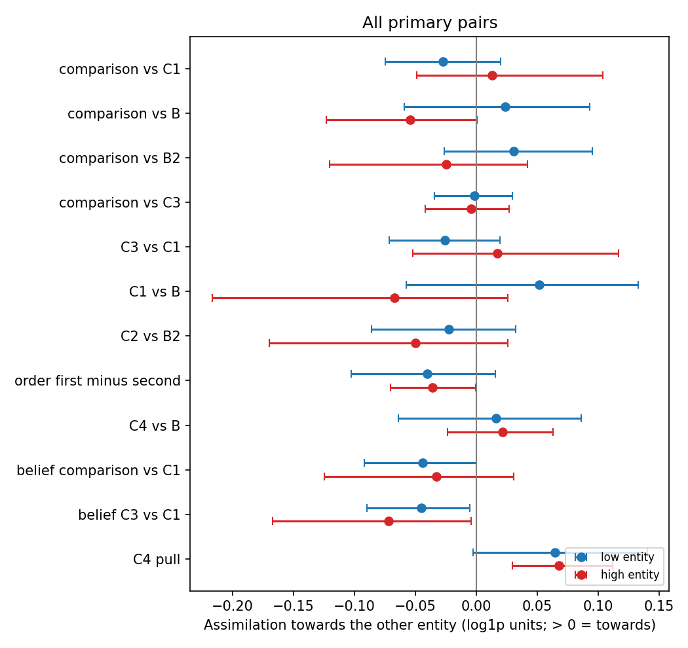
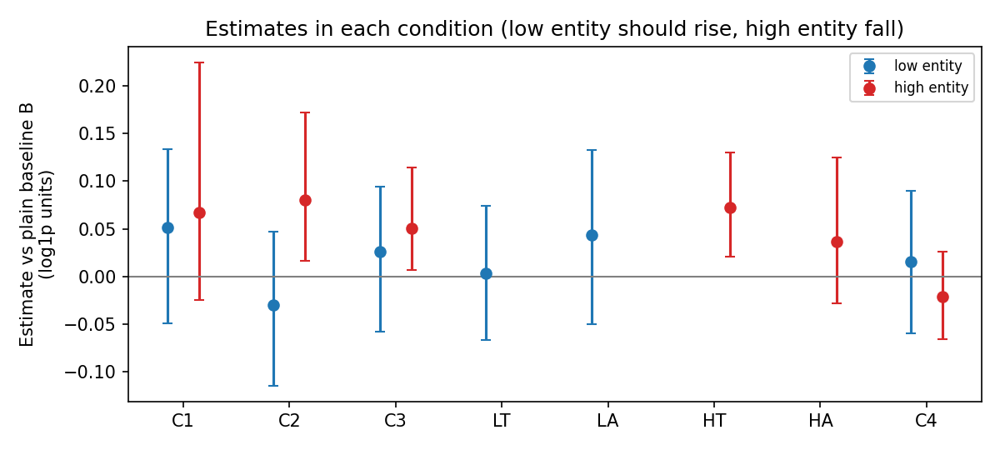
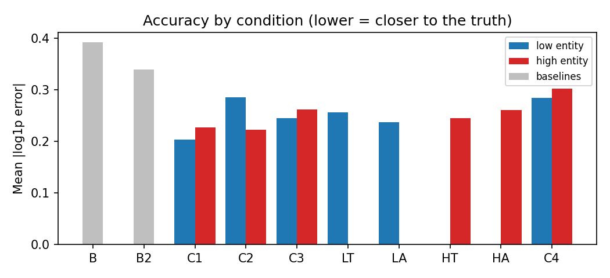
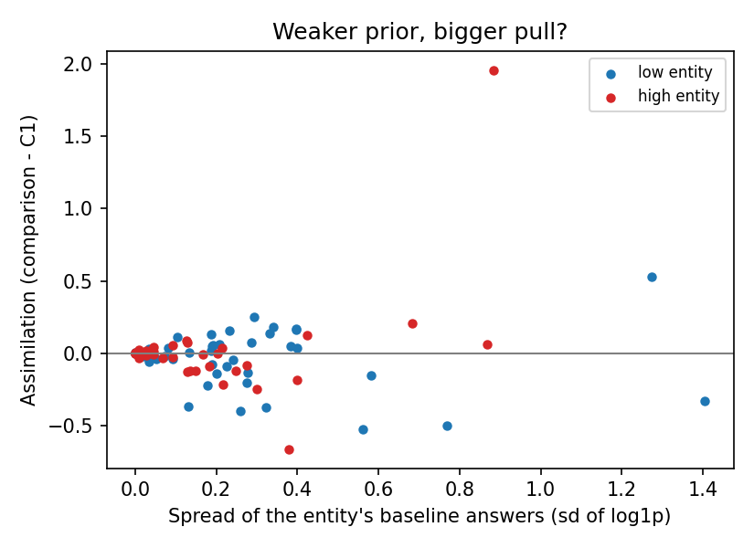
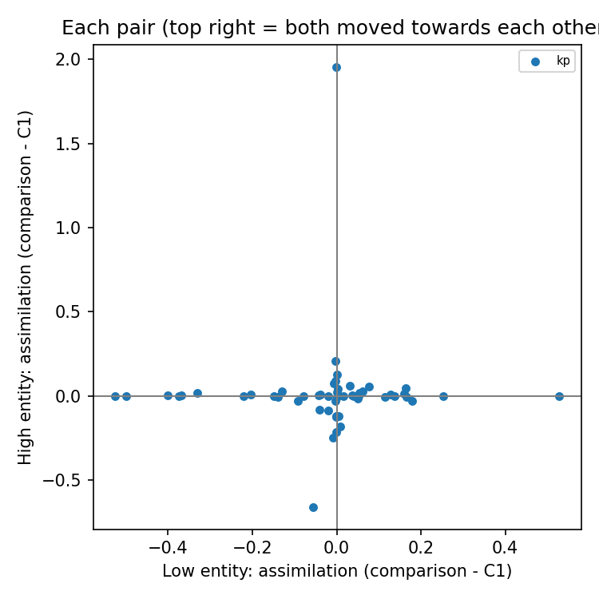

# Bidirectional anchoring: qwen3-32b (thinking off)

12090 trials, 12083 with a number; 54 pairs.

Assimilation is in log1p units: 0.10 means the estimate moved about 10% towards the other entity. Intervals are 95% bootstrap intervals over pairs. The two directions are tested separately. converge = (low + high) / 2 per pair: the two estimates move towards each other. common_shift = (low - high) / 2: both estimates rise together (also the low/high asymmetry). belief_* rows sign 'towards the partner' by the model's own baselines instead of the true values; C4_pull is the move towards the number given, measured from the model's own baseline.

## Main result (all primary pairs)

| contrast                 |   low_mean |   low_ci_lo |   low_ci_hi |   low_pairs |   high_mean |   high_ci_lo |   high_ci_hi |   high_pairs | pattern                 |   converge |   converge_ci_lo |   converge_ci_hi |   common_shift |   common_shift_ci_lo |   common_shift_ci_hi |
|:-------------------------|-----------:|------------:|------------:|------------:|------------:|-------------:|-------------:|-------------:|:------------------------|-----------:|-----------------:|-----------------:|---------------:|---------------------:|---------------------:|
| comparison_vs_C1         |     -0.028 |      -0.075 |       0.020 |          54 |       0.013 |       -0.049 |        0.104 |           54 | no reliable effect      |     -0.007 |           -0.048 |            0.046 |         -0.020 |               -0.068 |                0.021 |
| comparison_vs_B          |      0.024 |      -0.059 |       0.093 |          54 |      -0.055 |       -0.123 |        0.000 |           54 | no reliable effect      |     -0.015 |           -0.069 |            0.032 |          0.039 |               -0.011 |                0.088 |
| comparison_vs_B2         |      0.031 |      -0.026 |       0.095 |          54 |      -0.025 |       -0.121 |        0.042 |           54 | no reliable effect      |      0.003 |           -0.052 |            0.051 |          0.028 |               -0.018 |                0.082 |
| comparison_vs_C2         |      0.054 |       0.005 |       0.111 |          54 |       0.025 |       -0.005 |        0.063 |           54 | low entity only         |      0.040 |            0.010 |            0.071 |          0.014 |               -0.016 |                0.047 |
| comparison_vs_C3         |     -0.002 |      -0.035 |       0.030 |          54 |      -0.004 |       -0.042 |        0.027 |           54 | equivalent to no effect |     -0.003 |           -0.028 |            0.020 |          0.001 |               -0.022 |                0.024 |
| C3_vs_C1                 |     -0.026 |      -0.071 |       0.019 |          54 |       0.017 |       -0.052 |        0.116 |           54 | no reliable effect      |     -0.004 |           -0.046 |            0.050 |         -0.021 |               -0.073 |                0.020 |
| C1_vs_B                  |      0.051 |      -0.057 |       0.133 |          54 |      -0.067 |       -0.217 |        0.026 |           54 | no reliable effect      |     -0.008 |           -0.101 |            0.060 |          0.059 |               -0.013 |                0.143 |
| C2_vs_B2                 |     -0.023 |      -0.086 |       0.032 |          54 |      -0.050 |       -0.170 |        0.026 |           54 | no reliable effect      |     -0.037 |           -0.105 |            0.014 |          0.014 |               -0.038 |                0.078 |
| C2_vs_C1                 |     -0.081 |      -0.146 |      -0.024 |          54 |      -0.013 |       -0.060 |        0.052 |           54 | low entity moves away   |     -0.047 |           -0.086 |           -0.003 |         -0.034 |               -0.079 |                0.008 |
| order_first_minus_second |     -0.040 |      -0.103 |       0.016 |          54 |      -0.036 |       -0.070 |       -0.001 |           54 | high entity moves away  |     -0.038 |           -0.073 |           -0.005 |         -0.002 |               -0.038 |                0.031 |
| C4_vs_B                  |      0.016 |      -0.064 |       0.086 |          54 |       0.021 |       -0.024 |        0.063 |           54 | no reliable effect      |      0.019 |           -0.024 |            0.059 |         -0.003 |               -0.048 |                0.037 |
| belief_comparison_vs_C1  |     -0.044 |      -0.092 |       0.000 |          54 |      -0.033 |       -0.125 |        0.031 |           54 | no reliable effect      |     -0.038 |           -0.089 |            0.003 |         -0.006 |               -0.045 |                0.045 |
| belief_C3_vs_C1          |     -0.045 |      -0.090 |      -0.006 |          54 |      -0.072 |       -0.167 |       -0.004 |           54 | contrast (moves away)   |     -0.059 |           -0.111 |           -0.019 |          0.013 |               -0.028 |                0.067 |
| C4_pull                  |      0.064 |      -0.003 |       0.140 |          54 |       0.068 |        0.030 |        0.112 |           54 | high entity only        |      0.066 |            0.027 |            0.109 |         -0.002 |               -0.042 |                0.043 |

## Known partner: obscure item vs famous item

Each pair is one obscure item and one famous item. For each side, `low` = pairs where that item is the lower of the two (a pull towards the partner means its estimate goes up), `high` = pairs where it is the higher (goes down). Prediction: the obscure item moves in both directions, the famous one hardly moves. converge and common_shift are empty here because a side holds only one role per pair.

| kp_side   | contrast                |   low_mean |   low_ci_lo |   low_ci_hi |   low_pairs |   high_mean |   high_ci_lo |   high_ci_hi |   high_pairs | pattern                 |
|:----------|:------------------------|-----------:|------------:|------------:|------------:|------------:|-------------:|-------------:|-------------:|:------------------------|
| famous    | comparison_vs_C1        |     -0.005 |      -0.013 |       0.001 |          21 |       0.004 |       -0.002 |        0.010 |           33 | equivalent to no effect |
| famous    | comparison_vs_B         |     -0.001 |      -0.009 |       0.007 |          21 |       0.006 |        0.002 |        0.010 |           33 | high entity only        |
| famous    | comparison_vs_B2        |     -0.002 |      -0.017 |       0.012 |          21 |       0.007 |       -0.002 |        0.018 |           33 | equivalent to no effect |
| famous    | C3_vs_C1                |      0.000 |      -0.007 |       0.008 |          21 |      -0.002 |       -0.009 |        0.002 |           33 | equivalent to no effect |
| famous    | belief_comparison_vs_C1 |      0.002 |      -0.005 |       0.010 |          21 |       0.004 |       -0.002 |        0.010 |           33 | equivalent to no effect |
| famous    | C4_pull                 |      0.005 |      -0.003 |       0.015 |          21 |       0.042 |        0.014 |        0.080 |           33 | high entity only        |
| obscure   | comparison_vs_C1        |     -0.042 |      -0.119 |       0.032 |          33 |       0.027 |       -0.126 |        0.255 |           21 | no reliable effect      |
| obscure   | comparison_vs_B         |      0.039 |      -0.094 |       0.156 |          33 |      -0.149 |       -0.315 |       -0.005 |           21 | high entity moves away  |
| obscure   | comparison_vs_B2        |      0.052 |      -0.041 |       0.158 |          33 |      -0.075 |       -0.314 |        0.101 |           21 | no reliable effect      |
| obscure   | C3_vs_C1                |     -0.042 |      -0.114 |       0.027 |          33 |       0.047 |       -0.130 |        0.287 |           21 | no reliable effect      |
| obscure   | belief_comparison_vs_C1 |     -0.074 |      -0.151 |      -0.001 |          33 |      -0.090 |       -0.322 |        0.069 |           21 | low entity moves away   |
| obscure   | C4_pull                 |      0.102 |      -0.008 |       0.223 |          33 |       0.107 |        0.022 |        0.195 |           21 | high entity only        |

By domain:

| kp_side   | domain    | contrast                |   low_mean |   low_ci_lo |   low_ci_hi |   low_pairs |   high_mean |   high_ci_lo |   high_ci_hi |   high_pairs | pattern                 |
|:----------|:----------|:------------------------|-----------:|------------:|------------:|------------:|------------:|-------------:|-------------:|-------------:|:------------------------|
| famous    | buildings | comparison_vs_C1        |     -0.008 |      -0.023 |       0.006 |          10 |       0.004 |       -0.005 |        0.015 |           18 | equivalent to no effect |
| famous    | buildings | comparison_vs_B         |      0.005 |      -0.009 |       0.018 |          10 |       0.007 |        0.000 |        0.014 |           18 | high entity only        |
| famous    | buildings | comparison_vs_B2        |      0.006 |      -0.024 |       0.031 |          10 |       0.010 |       -0.005 |        0.027 |           18 | equivalent to no effect |
| famous    | buildings | C3_vs_C1                |      0.006 |      -0.005 |       0.020 |          10 |      -0.005 |       -0.015 |        0.004 |           18 | equivalent to no effect |
| famous    | buildings | belief_comparison_vs_C1 |      0.007 |      -0.008 |       0.022 |          10 |       0.005 |       -0.005 |        0.015 |           18 | equivalent to no effect |
| famous    | buildings | C4_pull                 |      0.014 |      -0.000 |       0.030 |          10 |       0.068 |        0.018 |        0.137 |           18 | high entity only        |
| famous    | mountains | comparison_vs_C1        |     -0.003 |      -0.007 |      -0.000 |          11 |       0.003 |       -0.001 |        0.007 |           15 | low entity moves away   |
| famous    | mountains | comparison_vs_B         |     -0.006 |      -0.015 |      -0.000 |          11 |       0.004 |        0.001 |        0.009 |           15 | low entity moves away   |
| famous    | mountains | comparison_vs_B2        |     -0.009 |      -0.022 |       0.000 |          11 |       0.004 |       -0.004 |        0.012 |           15 | equivalent to no effect |
| famous    | mountains | C3_vs_C1                |     -0.005 |      -0.015 |       0.002 |          11 |       0.000 |       -0.002 |        0.002 |           15 | equivalent to no effect |
| famous    | mountains | belief_comparison_vs_C1 |     -0.003 |      -0.007 |       0.001 |          11 |       0.003 |       -0.001 |        0.007 |           15 | equivalent to no effect |
| famous    | mountains | C4_pull                 |     -0.003 |      -0.009 |       0.003 |          11 |       0.011 |        0.005 |        0.017 |           15 | high entity only        |
| obscure   | buildings | comparison_vs_C1        |      0.070 |      -0.009 |       0.151 |          18 |      -0.141 |       -0.277 |       -0.037 |           10 | high entity moves away  |
| obscure   | buildings | comparison_vs_B         |      0.129 |      -0.098 |       0.308 |          18 |      -0.159 |       -0.354 |        0.030 |           10 | no reliable effect      |
| obscure   | buildings | comparison_vs_B2        |     -0.019 |      -0.136 |       0.096 |          18 |       0.104 |       -0.035 |        0.285 |           10 | no reliable effect      |
| obscure   | buildings | C3_vs_C1                |      0.023 |      -0.071 |       0.119 |          18 |      -0.094 |       -0.225 |        0.020 |           10 | no reliable effect      |
| obscure   | buildings | belief_comparison_vs_C1 |      0.012 |      -0.079 |       0.090 |          18 |       0.070 |       -0.050 |        0.226 |           10 | no reliable effect      |
| obscure   | buildings | C4_pull                 |      0.246 |       0.096 |       0.421 |          18 |       0.040 |       -0.071 |        0.189 |           10 | low entity only         |
| obscure   | mountains | comparison_vs_C1        |     -0.176 |      -0.286 |      -0.071 |          15 |       0.180 |       -0.054 |        0.559 |           11 | low entity moves away   |
| obscure   | mountains | comparison_vs_B         |     -0.068 |      -0.164 |       0.013 |          15 |      -0.140 |       -0.412 |        0.030 |           11 | no reliable effect      |
| obscure   | mountains | comparison_vs_B2        |      0.137 |       0.009 |       0.305 |          15 |      -0.238 |       -0.613 |        0.029 |           11 | low entity only         |
| obscure   | mountains | C3_vs_C1                |     -0.121 |      -0.213 |      -0.031 |          15 |       0.176 |       -0.136 |        0.599 |           11 | low entity moves away   |
| obscure   | mountains | belief_comparison_vs_C1 |     -0.176 |      -0.286 |      -0.071 |          15 |      -0.236 |       -0.598 |       -0.014 |           11 | contrast (moves away)   |
| obscure   | mountains | C4_pull                 |     -0.071 |      -0.173 |       0.021 |          15 |       0.169 |        0.079 |        0.276 |           11 | high entity only        |

## The comparison against each control

Each control moves the estimates by itself, so the comparison effect is shown against the plain baseline (B), the two-turn baseline (B2), the co-mention (C1) and the two-turn co-mention (C2: both names, then a letter-count question). `robust` = the 95% interval is on the same side of zero against every control that was run (+ = towards the partner).

| dataset   | role   | vs_B                    | vs_B2                   | vs_C1                   | vs_C2                   | robust   |
|:----------|:-------|:------------------------|:------------------------|:------------------------|:------------------------|:---------|
| kp        | low    | +0.024 [-0.059, +0.093] | +0.031 [-0.026, +0.095] | -0.028 [-0.075, +0.020] | +0.054 [+0.005, +0.111] | no       |
| kp        | high   | -0.055 [-0.123, +0.000] | -0.025 [-0.121, +0.042] | +0.013 [-0.049, +0.104] | +0.025 [-0.005, +0.063] | no       |

## Turn 1: does the model pick the first word offered?

`correct_answer_offered` = whether the right answer was the first or the second word in "MORE or FEWER" (or the reversed "FEWER or MORE"). Without a reflex `correct` is about the same in both rows; a model that always takes the first word scores 100% and 0%. `picked_first` = share of answers that took the first word; `reversed_share` = share of trials that offered the words reversed.

| dataset   | correct_answer_offered   |   trials |   correct |   picked_first |   reversed_share |
|:----------|:-------------------------|---------:|----------:|---------------:|-----------------:|
| kp        | first                    |     1079 |     0.837 |          0.837 |            0.000 |
| kp        | second                   |     1080 |     0.475 |          0.525 |            0.000 |

## By dataset

| dataset   | contrast                 |   low_mean |   low_ci_lo |   low_ci_hi |   low_pairs |   high_mean |   high_ci_lo |   high_ci_hi |   high_pairs | pattern                 |   converge |   converge_ci_lo |   converge_ci_hi |   common_shift |   common_shift_ci_lo |   common_shift_ci_hi |
|:----------|:-------------------------|-----------:|------------:|------------:|------------:|------------:|-------------:|-------------:|-------------:|:------------------------|-----------:|-----------------:|-----------------:|---------------:|---------------------:|---------------------:|
| kp        | comparison_vs_C1         |     -0.028 |      -0.075 |       0.020 |          54 |       0.013 |       -0.049 |        0.104 |           54 | no reliable effect      |     -0.007 |           -0.048 |            0.046 |         -0.020 |               -0.068 |                0.021 |
| kp        | comparison_vs_B          |      0.024 |      -0.059 |       0.093 |          54 |      -0.055 |       -0.123 |        0.000 |           54 | no reliable effect      |     -0.015 |           -0.069 |            0.032 |          0.039 |               -0.011 |                0.088 |
| kp        | comparison_vs_B2         |      0.031 |      -0.026 |       0.095 |          54 |      -0.025 |       -0.121 |        0.042 |           54 | no reliable effect      |      0.003 |           -0.052 |            0.051 |          0.028 |               -0.018 |                0.082 |
| kp        | comparison_vs_C2         |      0.054 |       0.005 |       0.111 |          54 |       0.025 |       -0.005 |        0.063 |           54 | low entity only         |      0.040 |            0.010 |            0.071 |          0.014 |               -0.016 |                0.047 |
| kp        | comparison_vs_C3         |     -0.002 |      -0.035 |       0.030 |          54 |      -0.004 |       -0.042 |        0.027 |           54 | equivalent to no effect |     -0.003 |           -0.028 |            0.020 |          0.001 |               -0.022 |                0.024 |
| kp        | C3_vs_C1                 |     -0.026 |      -0.071 |       0.019 |          54 |       0.017 |       -0.052 |        0.116 |           54 | no reliable effect      |     -0.004 |           -0.046 |            0.050 |         -0.021 |               -0.073 |                0.020 |
| kp        | C1_vs_B                  |      0.051 |      -0.057 |       0.133 |          54 |      -0.067 |       -0.217 |        0.026 |           54 | no reliable effect      |     -0.008 |           -0.101 |            0.060 |          0.059 |               -0.013 |                0.143 |
| kp        | C2_vs_B2                 |     -0.023 |      -0.086 |       0.032 |          54 |      -0.050 |       -0.170 |        0.026 |           54 | no reliable effect      |     -0.037 |           -0.105 |            0.014 |          0.014 |               -0.038 |                0.078 |
| kp        | C2_vs_C1                 |     -0.081 |      -0.146 |      -0.024 |          54 |      -0.013 |       -0.060 |        0.052 |           54 | low entity moves away   |     -0.047 |           -0.086 |           -0.003 |         -0.034 |               -0.079 |                0.008 |
| kp        | order_first_minus_second |     -0.040 |      -0.103 |       0.016 |          54 |      -0.036 |       -0.070 |       -0.001 |           54 | high entity moves away  |     -0.038 |           -0.073 |           -0.005 |         -0.002 |               -0.038 |                0.031 |
| kp        | C4_vs_B                  |      0.016 |      -0.064 |       0.086 |          54 |       0.021 |       -0.024 |        0.063 |           54 | no reliable effect      |      0.019 |           -0.024 |            0.059 |         -0.003 |               -0.048 |                0.037 |
| kp        | belief_comparison_vs_C1  |     -0.044 |      -0.092 |       0.000 |          54 |      -0.033 |       -0.125 |        0.031 |           54 | no reliable effect      |     -0.038 |           -0.089 |            0.003 |         -0.006 |               -0.045 |                0.045 |
| kp        | belief_C3_vs_C1          |     -0.045 |      -0.090 |      -0.006 |          54 |      -0.072 |       -0.167 |       -0.004 |           54 | contrast (moves away)   |     -0.059 |           -0.111 |           -0.019 |          0.013 |               -0.028 |                0.067 |
| kp        | C4_pull                  |      0.064 |      -0.003 |       0.140 |          54 |       0.068 |        0.030 |        0.112 |           54 | high entity only        |      0.066 |            0.027 |            0.109 |         -0.002 |               -0.042 |                0.043 |

## Self-consistency: by the turn-1 answer

| role   | turn1         |   trials |   mean_assim_vs_B |   contaminated |
|:-------|:--------------|---------:|------------------:|---------------:|
| high   | correct order |      715 |            -0.026 |          0.013 |
| high   | no            |        1 |            -0.270 |          1.000 |
| high   | wrong order   |      364 |            -0.110 |          0.000 |
| low    | correct order |      701 |             0.037 |          0.007 |
| low    | wrong order   |      379 |            -0.000 |          0.013 |

## Without trials whose turn-1 reply contained numbers

| contrast                 |   low_mean |   low_ci_lo |   low_ci_hi |   low_pairs |   high_mean |   high_ci_lo |   high_ci_hi |   high_pairs | pattern                 |   converge |   converge_ci_lo |   converge_ci_hi |   common_shift |   common_shift_ci_lo |   common_shift_ci_hi |
|:-------------------------|-----------:|------------:|------------:|------------:|------------:|-------------:|-------------:|-------------:|:------------------------|-----------:|-----------------:|-----------------:|---------------:|---------------------:|---------------------:|
| comparison_vs_C1         |     -0.029 |      -0.076 |       0.018 |          54 |       0.013 |       -0.049 |        0.105 |           54 | no reliable effect      |     -0.008 |           -0.048 |            0.045 |         -0.021 |               -0.069 |                0.020 |
| comparison_vs_B          |      0.022 |      -0.061 |       0.091 |          54 |      -0.054 |       -0.124 |        0.001 |           54 | no reliable effect      |     -0.016 |           -0.069 |            0.031 |          0.038 |               -0.012 |                0.087 |
| comparison_vs_B2         |      0.029 |      -0.028 |       0.093 |          54 |      -0.025 |       -0.120 |        0.043 |           54 | no reliable effect      |      0.002 |           -0.052 |            0.050 |          0.027 |               -0.019 |                0.081 |
| comparison_vs_C2         |      0.010 |      -0.036 |       0.056 |          50 |       0.036 |       -0.022 |        0.096 |           49 | no reliable effect      |      0.023 |           -0.013 |            0.060 |         -0.015 |               -0.055 |                0.024 |
| comparison_vs_C3         |     -0.004 |      -0.037 |       0.029 |          54 |      -0.004 |       -0.043 |        0.028 |           54 | equivalent to no effect |     -0.004 |           -0.029 |            0.020 |          0.000 |               -0.023 |                0.023 |
| C3_vs_C1                 |     -0.026 |      -0.071 |       0.019 |          54 |       0.017 |       -0.052 |        0.116 |           54 | no reliable effect      |     -0.004 |           -0.046 |            0.050 |         -0.021 |               -0.073 |                0.020 |
| C1_vs_B                  |      0.051 |      -0.057 |       0.133 |          54 |      -0.067 |       -0.217 |        0.026 |           54 | no reliable effect      |     -0.008 |           -0.101 |            0.060 |          0.059 |               -0.013 |                0.143 |
| C2_vs_B2                 |      0.025 |      -0.044 |       0.094 |          50 |      -0.065 |       -0.214 |        0.041 |           49 | no reliable effect      |     -0.016 |           -0.097 |            0.048 |          0.052 |               -0.009 |                0.131 |
| C2_vs_C1                 |     -0.039 |      -0.098 |       0.014 |          50 |      -0.026 |       -0.080 |        0.036 |           49 | no reliable effect      |     -0.030 |           -0.065 |            0.009 |         -0.003 |               -0.047 |                0.036 |
| order_first_minus_second |     -0.044 |      -0.106 |       0.013 |          54 |      -0.037 |       -0.072 |       -0.001 |           54 | high entity moves away  |     -0.040 |           -0.075 |           -0.007 |         -0.003 |               -0.040 |                0.030 |
| C4_vs_B                  |      0.016 |      -0.064 |       0.086 |          54 |       0.021 |       -0.024 |        0.063 |           54 | no reliable effect      |      0.019 |           -0.024 |            0.059 |         -0.003 |               -0.048 |                0.037 |
| belief_comparison_vs_C1  |     -0.046 |      -0.093 |      -0.001 |          54 |      -0.031 |       -0.122 |        0.032 |           54 | low entity moves away   |     -0.038 |           -0.088 |            0.003 |         -0.007 |               -0.047 |                0.043 |
| belief_C3_vs_C1          |     -0.045 |      -0.090 |      -0.006 |          54 |      -0.072 |       -0.167 |       -0.004 |           54 | contrast (moves away)   |     -0.059 |           -0.111 |           -0.019 |          0.013 |               -0.028 |                0.067 |
| C4_pull                  |      0.064 |      -0.003 |       0.140 |          54 |       0.068 |        0.030 |        0.112 |           54 | high entity only        |      0.066 |            0.027 |            0.109 |         -0.002 |               -0.042 |                0.043 |

## Robustness: whole-tournament totals

| contrast                 |   low_mean |   low_ci_lo |   low_ci_hi |   low_pairs |   high_mean |   high_ci_lo |   high_ci_hi |   high_pairs | pattern         |   converge |   converge_ci_lo |   converge_ci_hi |   common_shift |   common_shift_ci_lo |   common_shift_ci_hi |
|:-------------------------|-----------:|------------:|------------:|------------:|------------:|-------------:|-------------:|-------------:|:----------------|-----------:|-----------------:|-----------------:|---------------:|---------------------:|---------------------:|
| comparison_vs_C1         |        nan |         nan |         nan |           0 |         nan |          nan |          nan |            0 | not enough data |        nan |              nan |              nan |            nan |                  nan |                  nan |
| comparison_vs_B          |        nan |         nan |         nan |           0 |         nan |          nan |          nan |            0 | not enough data |        nan |              nan |              nan |            nan |                  nan |                  nan |
| comparison_vs_B2         |        nan |         nan |         nan |           0 |         nan |          nan |          nan |            0 | not enough data |        nan |              nan |              nan |            nan |                  nan |                  nan |
| comparison_vs_C2         |        nan |         nan |         nan |           0 |         nan |          nan |          nan |            0 | not enough data |        nan |              nan |              nan |            nan |                  nan |                  nan |
| comparison_vs_C3         |        nan |         nan |         nan |           0 |         nan |          nan |          nan |            0 | not enough data |        nan |              nan |              nan |            nan |                  nan |                  nan |
| C3_vs_C1                 |        nan |         nan |         nan |           0 |         nan |          nan |          nan |            0 | not enough data |        nan |              nan |              nan |            nan |                  nan |                  nan |
| C1_vs_B                  |        nan |         nan |         nan |           0 |         nan |          nan |          nan |            0 | not enough data |        nan |              nan |              nan |            nan |                  nan |                  nan |
| C2_vs_B2                 |        nan |         nan |         nan |           0 |         nan |          nan |          nan |            0 | not enough data |        nan |              nan |              nan |            nan |                  nan |                  nan |
| C2_vs_C1                 |        nan |         nan |         nan |           0 |         nan |          nan |          nan |            0 | not enough data |        nan |              nan |              nan |            nan |                  nan |                  nan |
| order_first_minus_second |        nan |         nan |         nan |           0 |         nan |          nan |          nan |            0 | not enough data |        nan |              nan |              nan |            nan |                  nan |                  nan |
| C4_vs_B                  |        nan |         nan |         nan |           0 |         nan |          nan |          nan |            0 | not enough data |        nan |              nan |              nan |            nan |                  nan |                  nan |
| belief_comparison_vs_C1  |        nan |         nan |         nan |           0 |         nan |          nan |          nan |            0 | not enough data |        nan |              nan |              nan |            nan |                  nan |                  nan |
| belief_C3_vs_C1          |        nan |         nan |         nan |           0 |         nan |          nan |          nan |            0 | not enough data |        nan |              nan |              nan |            nan |                  nan |                  nan |
| C4_pull                  |        nan |         nan |         nan |           0 |         nan |          nan |          nan |            0 | not enough data |        nan |              nan |              nan |            nan |                  nan |                  nan |

## Mixed model with a comparison slope per pair

Trial level, comparison vs one control, each direction separately; every pair has its own level and its own comparison effect (`slope_sd` = how much that effect varies between pairs). This matches the pair bootstrap, which stays the primary test.

| role   | contrast         |   n_trials |   n_pairs |   coef |    se |   ci_lo |   ci_hi |     p |   slope_sd | converged   |
|:-------|:-----------------|-----------:|----------:|-------:|------:|--------:|--------:|------:|-----------:|:------------|
| low    | comparison_vs_C1 |       2158 |        54 | -0.028 | 0.025 |  -0.076 |   0.021 | 0.262 |      0.149 | True        |
| low    | comparison_vs_C2 |       2158 |        54 |  0.054 | 0.027 |   0.000 |   0.107 | 0.049 |      0.155 | True        |
| high   | comparison_vs_C1 |       2159 |        54 |  0.013 | 0.040 |  -0.065 |   0.091 | 0.748 |      0.284 | True        |
| high   | comparison_vs_C2 |       2159 |        54 |  0.025 | 0.018 |  -0.009 |   0.060 | 0.153 |      0.099 | True        |

## Mixed model, intercepts only (too confident; kept for comparison)

Here every pair shares one comparison effect, so its p values are too small. Read the model above.

| term                                                                     |   coef |      se |   ci_lo |   ci_hi |       p |   n_trials |   n_pairs | converged   |
|:-------------------------------------------------------------------------|-------:|--------:|--------:|--------:|--------:|-----------:|----------:|:------------|
| Intercept                                                                |  0.051 |   0.175 |  -0.293 |   0.395 |   0.772 |       8633 |        54 | True        |
| C(cond, Treatment('C1'))[T.C2]                                           | -0.081 |   0.014 |  -0.108 |  -0.054 |   0.000 |       8633 |        54 | True        |
| C(cond, Treatment('C1'))[T.C3]                                           | -0.025 |   0.014 |  -0.052 |   0.002 |   0.071 |       8633 |        54 | True        |
| C(cond, Treatment('C1'))[T.comparison]                                   | -0.027 |   0.014 |  -0.054 |   0.000 |   0.051 |       8633 |        54 | True        |
| C(role, Treatment('low'))[T.high]                                        | -0.118 |   0.248 |  -0.605 |   0.368 |   0.634 |       8633 |        54 | True        |
| C(cond, Treatment('C1'))[T.C2]:C(role, Treatment('low'))[T.high]         |  0.068 |   0.020 |   0.030 |   0.107 |   0.001 |       8633 |        54 | True        |
| C(cond, Treatment('C1'))[T.C3]:C(role, Treatment('low'))[T.high]         |  0.042 |   0.020 |   0.004 |   0.080 |   0.032 |       8633 |        54 | True        |
| C(cond, Treatment('C1'))[T.comparison]:C(role, Treatment('low'))[T.high] |  0.040 |   0.020 |   0.001 |   0.078 |   0.042 |       8633 |        54 | True        |
| entity Var                                                               | 16.000 | nan     | nan     | nan     | nan     |       8633 |        54 | True        |

## Accuracy

| condition   | role   |   trials |   abs_log_error |   signed_log_error |   median_rel_error |
|:------------|:-------|---------:|----------------:|-------------------:|-------------------:|
| B           |        |     1580 |           0.392 |             -0.211 |             -0.005 |
| B2          |        |      790 |           0.339 |             -0.196 |             -0.008 |
| C1          | high   |     1079 |           0.226 |             -0.175 |             -0.000 |
| C1          | low    |     1078 |           0.203 |             -0.019 |              0.000 |
| C2          | high   |     1079 |           0.222 |             -0.162 |             -0.006 |
| C2          | low    |     1078 |           0.285 |             -0.100 |             -0.011 |
| C3          | high   |     1080 |           0.261 |             -0.193 |             -0.000 |
| C3          | low    |     1079 |           0.245 |             -0.044 |              0.000 |
| C4          | high   |      540 |           0.302 |             -0.265 |             -0.017 |
| C4          | low    |      540 |           0.284 |             -0.055 |              0.000 |
| HA          | high   |      540 |           0.260 |             -0.207 |             -0.005 |
| HT          | high   |      540 |           0.245 |             -0.171 |             -0.001 |
| LA          | low    |      540 |           0.236 |             -0.027 |              0.000 |
| LT          | low    |      540 |           0.257 |             -0.067 |             -0.001 |

## Prior strength

| role   |   pairs |   r_sd_B_vs_assim |   slope | uncertainty          |   mean_assim_comparison_vs_C1 |
|:-------|--------:|------------------:|--------:|:---------------------|------------------------------:|
| high   |      54 |             0.434 |   0.634 | nan                  |                       nan     |
| high   |      12 |           nan     | nan     | high uncertainty     |                         0.129 |
| high   |       6 |           nan     | nan     | moderate             |                        -0.047 |
| high   |       6 |           nan     | nan     | strong prior         |                        -0.107 |
| high   |      30 |           nan     | nan     | strong prior (known) |                         0.002 |
| low    |      54 |            -0.089 |  -0.057 | nan                  |                       nan     |
| low    |      25 |           nan     | nan     | high uncertainty     |                        -0.049 |
| low    |       9 |           nan     | nan     | moderate             |                        -0.019 |
| low    |      20 |           nan     | nan     | strong prior (known) |                        -0.005 |

## Triplets

(none)

## Replies without a number

| condition   |   ok |   refusal |
|:------------|-----:|----------:|
| B           | 1580 |         0 |
| B2          |  790 |         0 |
| C1          | 2157 |         3 |
| C2          | 2157 |         3 |
| C3          | 2159 |         1 |
| C4          | 1080 |         0 |
| HA          |  540 |         0 |
| HT          |  540 |         0 |
| LA          |  540 |         0 |
| LT          |  540 |         0 |

