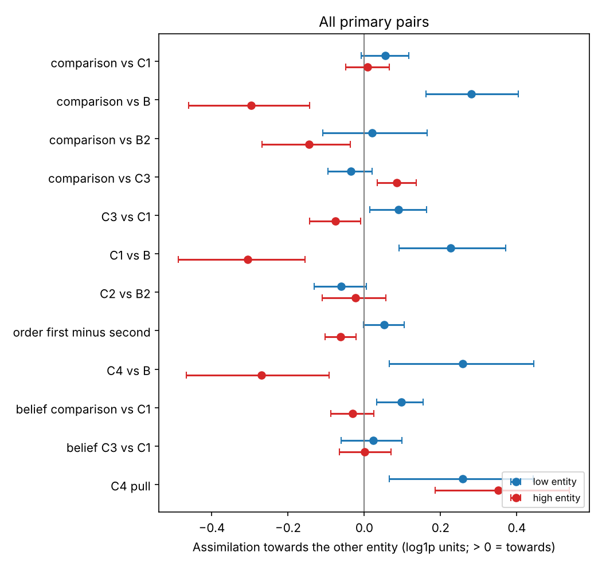
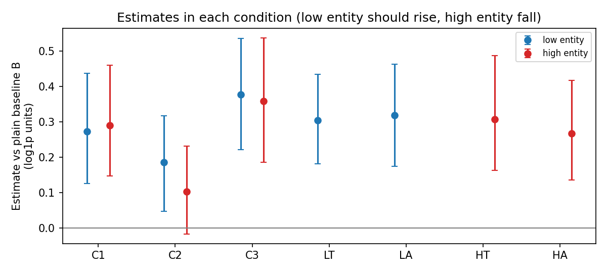
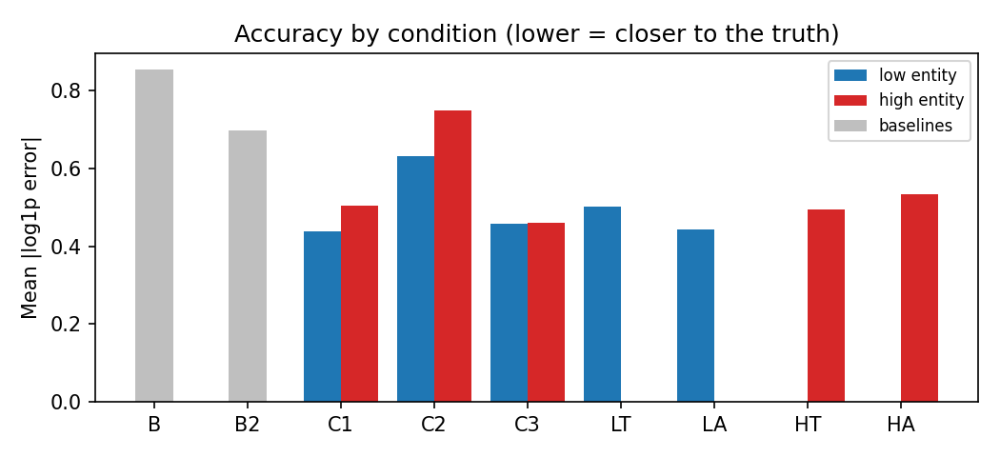
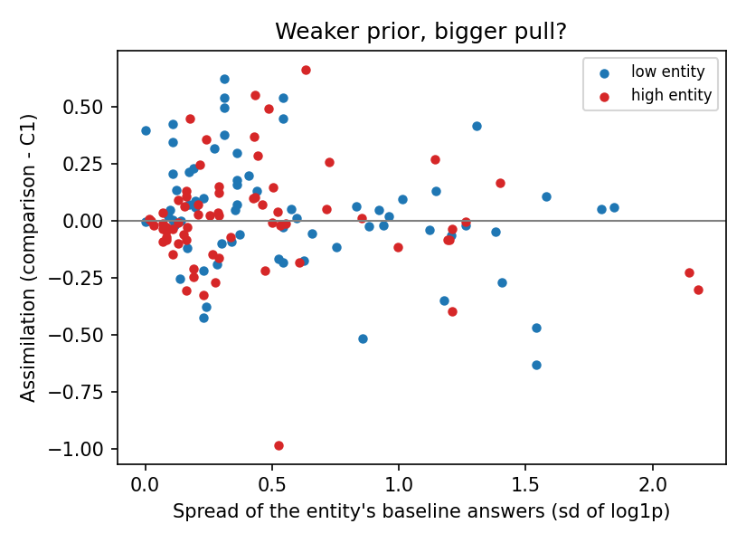
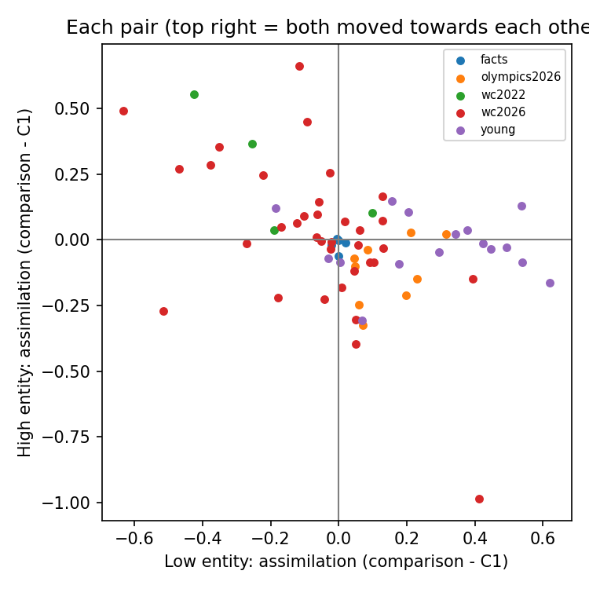

# Bidirectional anchoring: qwen3-32b (thinking off)

15150 trials, 15148 with a number; 69 pairs.

Assimilation is in log1p units: 0.10 means the estimate moved about 10% towards the other entity. Intervals are 95% bootstrap intervals over pairs. The two directions are tested separately. converge = (low + high) / 2 per pair: the two estimates move towards each other. common_shift = (low - high) / 2: both estimates rise together (also the low/high asymmetry). belief_* rows sign 'towards the partner' by the model's own baselines instead of the true values; C4_pull is the move towards the number given, measured from the model's own baseline.

## Main result (all primary pairs)

| contrast                 |   low_mean |   low_ci_lo |   low_ci_hi |   low_pairs |   high_mean |   high_ci_lo |   high_ci_hi |   high_pairs | pattern                    |   converge |   converge_ci_lo |   converge_ci_hi |   common_shift |   common_shift_ci_lo |   common_shift_ci_hi |
|:-------------------------|-----------:|------------:|------------:|------------:|------------:|-------------:|-------------:|-------------:|:---------------------------|-----------:|-----------------:|-----------------:|---------------:|---------------------:|---------------------:|
| comparison_vs_C1         |      0.054 |      -0.008 |       0.117 |          61 |       0.008 |       -0.048 |        0.065 |           61 | no reliable effect         |      0.031 |           -0.001 |            0.064 |          0.023 |               -0.029 |                0.072 |
| comparison_vs_B          |      0.281 |       0.162 |       0.404 |          61 |      -0.298 |       -0.462 |       -0.144 |           61 | high entity moves away     |     -0.009 |           -0.085 |            0.063 |          0.289 |                0.170 |                0.416 |
| comparison_vs_B2         |      0.021 |      -0.109 |       0.165 |          61 |      -0.145 |       -0.268 |       -0.037 |           61 | high entity moves away     |     -0.062 |           -0.125 |           -0.004 |          0.083 |               -0.024 |                0.204 |
| comparison_vs_C2         |      0.082 |      -0.034 |       0.214 |          61 |      -0.122 |       -0.227 |       -0.025 |           61 | high entity moves away     |     -0.020 |           -0.068 |            0.026 |          0.102 |                0.007 |                0.213 |
| comparison_vs_C3         |     -0.036 |      -0.095 |       0.021 |          61 |       0.085 |        0.034 |        0.136 |           61 | high entity only           |      0.025 |           -0.005 |            0.055 |         -0.060 |               -0.106 |               -0.017 |
| C3_vs_C1                 |      0.090 |       0.015 |       0.163 |          61 |      -0.077 |       -0.144 |       -0.010 |           61 | high entity moves away     |      0.007 |           -0.026 |            0.038 |          0.083 |                0.019 |                0.147 |
| C1_vs_B                  |      0.226 |       0.091 |       0.370 |          61 |      -0.306 |       -0.487 |       -0.155 |           61 | high entity moves away     |     -0.040 |           -0.122 |            0.040 |          0.266 |                0.138 |                0.404 |
| C2_vs_B2                 |     -0.061 |      -0.131 |       0.005 |          61 |      -0.024 |       -0.111 |        0.057 |           61 | no reliable effect         |     -0.042 |           -0.090 |            0.005 |         -0.019 |               -0.079 |                0.046 |
| C2_vs_C1                 |     -0.027 |      -0.178 |       0.111 |          61 |       0.130 |        0.024 |        0.255 |           61 | high entity only           |      0.051 |           -0.007 |            0.111 |         -0.079 |               -0.200 |                0.035 |
| order_first_minus_second |      0.051 |      -0.002 |       0.105 |          61 |      -0.062 |       -0.103 |       -0.022 |           61 | high entity moves away     |     -0.005 |           -0.039 |            0.027 |          0.057 |                0.024 |                0.090 |
| C4_vs_B                  |      0.258 |       0.065 |       0.445 |          45 |      -0.270 |       -0.467 |       -0.093 |           45 | high entity moves away     |     -0.006 |           -0.110 |            0.086 |          0.264 |                0.101 |                0.433 |
| belief_comparison_vs_C1  |      0.097 |       0.033 |       0.155 |          61 |      -0.031 |       -0.087 |        0.025 |           61 | low entity only            |      0.033 |            0.002 |            0.065 |          0.064 |                0.012 |                0.109 |
| belief_C3_vs_C1          |      0.023 |      -0.061 |       0.098 |          61 |       0.001 |       -0.065 |        0.070 |           61 | no reliable effect         |      0.012 |           -0.020 |            0.043 |          0.011 |               -0.057 |                0.075 |
| C4_pull                  |      0.258 |       0.066 |       0.443 |          45 |       0.351 |        0.186 |        0.538 |           45 | bidirectional assimilation |      0.304 |            0.156 |            0.461 |         -0.047 |               -0.161 |                0.049 |

## The comparison against each control

Each control moves the estimates by itself, so the comparison effect is shown against the plain baseline (B), the two-turn baseline (B2), the co-mention (C1) and the two-turn co-mention (C2: both names, then a letter-count question). `robust` = the 95% interval is on the same side of zero against every control that was run (+ = towards the partner).

| dataset      | role   | vs_B                    | vs_B2                   | vs_C1                   | vs_C2                   | robust   |
|:-------------|:-------|:------------------------|:------------------------|:------------------------|:------------------------|:---------|
| facts        | low    | +0.009 [-0.005, +0.032] | -0.007 [-0.026, +0.012] | -0.001 [-0.014, +0.011] | +0.013 [-0.009, +0.048] | no       |
| facts        | high   | +0.005 [-0.020, +0.033] | -0.017 [-0.061, +0.018] | -0.018 [-0.041, -0.001] | -0.044 [-0.125, +0.003] | no       |
| olympics2026 | low    | +0.170 [+0.062, +0.285] | -0.107 [-0.402, +0.185] | +0.140 [+0.079, +0.201] | -0.085 [-0.363, +0.215] | no       |
| olympics2026 | high   | -0.130 [-0.205, -0.059] | -0.236 [-0.460, -0.048] | -0.121 [-0.201, -0.050] | -0.065 [-0.185, +0.059] | no       |
| wc2022       | low    | -0.052 [-0.375, +0.278] | -0.128 [-0.475, +0.220] | -0.193 [-0.366, +0.010] | -0.030 [-0.387, +0.283] | no       |
| wc2022       | high   | -0.073 [-0.296, +0.150] | +0.067 [-0.180, +0.313] | +0.264 [+0.069, +0.459] | +0.098 [-0.185, +0.429] | no       |
| wc2026       | low    | +0.617 [+0.414, +0.818] | +0.327 [+0.135, +0.555] | -0.061 [-0.148, +0.026] | +0.277 [+0.066, +0.510] | no       |
| wc2026       | high   | -0.671 [-0.983, -0.388] | -0.350 [-0.569, -0.151] | +0.037 [-0.082, +0.143] | -0.296 [-0.501, -0.118] | no       |
| young        | low    | -0.058 [-0.177, +0.054] | -0.379 [-0.534, -0.222] | +0.279 [+0.162, +0.387] | -0.104 [-0.200, -0.007] | no       |
| young        | high   | +0.088 [-0.027, +0.219] | +0.158 [+0.053, +0.277] | -0.023 [-0.081, +0.034] | +0.061 [+0.020, +0.115] | no       |

## Turn 1: does the model pick the first word offered?

`correct_answer_offered` = whether the right answer was the first or the second word in "MORE or FEWER" (or the reversed "FEWER or MORE"). Without a reflex `correct` is about the same in both rows; a model that always takes the first word scores 100% and 0%. `picked_first` = share of answers that took the first word; `reversed_share` = share of trials that offered the words reversed.

| dataset      | correct_answer_offered   |   trials |   correct |   picked_first |   reversed_share |
|:-------------|:-------------------------|---------:|----------:|---------------:|-----------------:|
| facts        | first                    |      100 |     0.890 |          0.890 |            0.000 |
| facts        | second                   |      100 |     0.560 |          0.440 |            0.000 |
| olympics2026 | first                    |      180 |     0.906 |          0.906 |            0.000 |
| olympics2026 | second                   |      179 |     0.480 |          0.520 |            0.000 |
| wc2022       | first                    |       80 |     0.950 |          0.950 |            0.000 |
| wc2022       | second                   |       80 |     0.287 |          0.713 |            0.000 |
| wc2026       | first                    |      699 |     0.567 |          0.567 |            0.000 |
| wc2026       | second                   |      698 |     0.532 |          0.468 |            0.000 |
| young        | first                    |      320 |     1.000 |          1.000 |            0.000 |
| young        | second                   |      320 |     0.269 |          0.731 |            0.000 |

## By dataset

| dataset      | contrast                 |   low_mean |   low_ci_lo |   low_ci_hi |   low_pairs |   high_mean |   high_ci_lo |   high_ci_hi |   high_pairs | pattern                    |   converge |   converge_ci_lo |   converge_ci_hi |   common_shift |   common_shift_ci_lo |   common_shift_ci_hi |
|:-------------|:-------------------------|-----------:|------------:|------------:|------------:|------------:|-------------:|-------------:|-------------:|:---------------------------|-----------:|-----------------:|-----------------:|---------------:|---------------------:|---------------------:|
| facts        | comparison_vs_C1         |     -0.001 |      -0.014 |       0.011 |           5 |      -0.018 |       -0.041 |       -0.001 |            5 | high entity moves away     |     -0.010 |           -0.023 |            0.002 |          0.008 |               -0.001 |                0.021 |
| facts        | comparison_vs_B          |      0.009 |      -0.005 |       0.032 |           5 |       0.005 |       -0.020 |        0.033 |            5 | equivalent to no effect    |      0.007 |           -0.009 |            0.023 |          0.002 |               -0.014 |                0.016 |
| facts        | comparison_vs_B2         |     -0.007 |      -0.026 |       0.012 |           5 |      -0.017 |       -0.061 |        0.018 |            5 | no reliable effect         |     -0.012 |           -0.038 |            0.006 |          0.005 |               -0.019 |                0.025 |
| facts        | comparison_vs_C2         |      0.013 |      -0.009 |       0.048 |           5 |      -0.044 |       -0.125 |        0.003 |            5 | no reliable effect         |     -0.016 |           -0.061 |            0.015 |          0.028 |               -0.005 |                0.072 |
| facts        | comparison_vs_C3         |     -0.014 |      -0.025 |      -0.003 |           5 |      -0.007 |       -0.020 |        0.004 |            5 | low entity moves away      |     -0.010 |           -0.017 |           -0.005 |         -0.004 |               -0.012 |                0.006 |
| facts        | C3_vs_C1                 |      0.013 |      -0.001 |       0.027 |           5 |      -0.011 |       -0.028 |        0.006 |            5 | equivalent to no effect    |      0.001 |           -0.013 |            0.015 |          0.012 |                0.004 |                0.018 |
| facts        | C1_vs_B                  |      0.010 |      -0.011 |       0.036 |           5 |       0.023 |       -0.012 |        0.073 |            5 | no reliable effect         |      0.016 |           -0.008 |            0.041 |         -0.006 |               -0.035 |                0.015 |
| facts        | C2_vs_B2                 |     -0.020 |      -0.067 |       0.018 |           5 |       0.028 |       -0.041 |        0.117 |            5 | no reliable effect         |      0.004 |           -0.052 |            0.056 |         -0.024 |               -0.064 |                0.007 |
| facts        | C2_vs_C1                 |     -0.014 |      -0.051 |       0.016 |           5 |       0.026 |       -0.012 |        0.088 |            5 | no reliable effect         |      0.006 |           -0.019 |            0.040 |         -0.020 |               -0.054 |                0.009 |
| facts        | order_first_minus_second |      0.013 |      -0.008 |       0.038 |           5 |       0.029 |       -0.004 |        0.079 |            5 | no reliable effect         |      0.021 |           -0.004 |            0.047 |         -0.008 |               -0.035 |                0.013 |
| facts        | C4_vs_B                  |      0.040 |       0.004 |       0.076 |           5 |       0.076 |        0.013 |        0.140 |            5 | bidirectional assimilation |      0.058 |            0.030 |            0.082 |         -0.018 |               -0.062 |                0.025 |
| facts        | belief_comparison_vs_C1  |     -0.001 |      -0.014 |       0.011 |           5 |      -0.018 |       -0.041 |       -0.001 |            5 | high entity moves away     |     -0.010 |           -0.023 |            0.002 |          0.008 |               -0.001 |                0.021 |
| facts        | belief_C3_vs_C1          |      0.013 |      -0.001 |       0.027 |           5 |      -0.011 |       -0.028 |        0.006 |            5 | equivalent to no effect    |      0.001 |           -0.013 |            0.015 |          0.012 |                0.004 |                0.018 |
| facts        | C4_pull                  |      0.040 |       0.004 |       0.076 |           5 |       0.076 |        0.013 |        0.140 |            5 | bidirectional assimilation |      0.058 |            0.030 |            0.082 |         -0.018 |               -0.062 |                0.025 |
| olympics2026 | comparison_vs_C1         |      0.140 |       0.079 |       0.201 |           9 |      -0.121 |       -0.201 |       -0.050 |            9 | high entity moves away     |      0.009 |           -0.049 |            0.066 |          0.131 |                0.093 |                0.167 |
| olympics2026 | comparison_vs_B          |      0.170 |       0.062 |       0.285 |           9 |      -0.130 |       -0.205 |       -0.059 |            9 | high entity moves away     |      0.020 |           -0.052 |            0.093 |          0.150 |                0.086 |                0.208 |
| olympics2026 | comparison_vs_B2         |     -0.107 |      -0.402 |       0.185 |           9 |      -0.236 |       -0.460 |       -0.048 |            9 | high entity moves away     |     -0.171 |           -0.354 |            0.038 |          0.064 |               -0.096 |                0.223 |
| olympics2026 | comparison_vs_C2         |     -0.085 |      -0.363 |       0.215 |           9 |      -0.065 |       -0.185 |        0.059 |            9 | no reliable effect         |     -0.075 |           -0.248 |            0.100 |         -0.010 |               -0.136 |                0.126 |
| olympics2026 | comparison_vs_C3         |      0.069 |       0.022 |       0.109 |           9 |      -0.108 |       -0.158 |       -0.054 |            9 | high entity moves away     |     -0.019 |           -0.054 |            0.019 |          0.089 |                0.060 |                0.119 |
| olympics2026 | C3_vs_C1                 |      0.071 |       0.000 |       0.137 |           9 |      -0.013 |       -0.086 |        0.061 |            9 | low entity only            |      0.029 |           -0.035 |            0.086 |          0.042 |                0.004 |                0.077 |
| olympics2026 | C1_vs_B                  |      0.030 |      -0.086 |       0.168 |           9 |      -0.008 |       -0.103 |        0.095 |            9 | no reliable effect         |      0.011 |           -0.073 |            0.104 |          0.019 |               -0.046 |                0.087 |
| olympics2026 | C2_vs_B2                 |     -0.022 |      -0.100 |       0.058 |           9 |      -0.171 |       -0.460 |        0.018 |            9 | no reliable effect         |     -0.096 |           -0.209 |           -0.030 |          0.075 |               -0.055 |                0.253 |
| olympics2026 | C2_vs_C1                 |      0.226 |      -0.103 |       0.534 |           9 |      -0.057 |       -0.245 |        0.093 |            9 | no reliable effect         |      0.084 |           -0.123 |            0.284 |          0.141 |               -0.007 |                0.283 |
| olympics2026 | order_first_minus_second |     -0.047 |      -0.143 |       0.045 |           9 |      -0.011 |       -0.120 |        0.087 |            9 | no reliable effect         |     -0.029 |           -0.099 |            0.039 |         -0.018 |               -0.089 |                0.053 |
| olympics2026 | C4_vs_B                  |      0.079 |      -0.058 |       0.219 |           9 |       0.067 |       -0.057 |        0.185 |            9 | no reliable effect         |      0.073 |            0.018 |            0.137 |          0.006 |               -0.105 |                0.118 |
| olympics2026 | belief_comparison_vs_C1  |      0.140 |       0.079 |       0.201 |           9 |      -0.121 |       -0.201 |       -0.050 |            9 | high entity moves away     |      0.009 |           -0.049 |            0.066 |          0.131 |                0.093 |                0.167 |
| olympics2026 | belief_C3_vs_C1          |      0.071 |       0.000 |       0.137 |           9 |      -0.013 |       -0.086 |        0.061 |            9 | low entity only            |      0.029 |           -0.035 |            0.086 |          0.042 |                0.004 |                0.077 |
| olympics2026 | C4_pull                  |      0.116 |      -0.004 |       0.240 |           9 |       0.067 |       -0.057 |        0.185 |            9 | no reliable effect         |      0.091 |            0.031 |            0.156 |          0.025 |               -0.079 |                0.128 |
| wc2022       | comparison_vs_C1         |     -0.193 |      -0.366 |       0.010 |           4 |       0.264 |        0.069 |        0.459 |            4 | high entity only           |      0.035 |           -0.042 |            0.089 |         -0.228 |               -0.399 |               -0.057 |
| wc2022       | comparison_vs_B          |     -0.052 |      -0.375 |       0.278 |           4 |      -0.073 |       -0.296 |        0.150 |            4 | no reliable effect         |     -0.062 |           -0.165 |            0.038 |          0.011 |               -0.263 |                0.284 |
| wc2022       | comparison_vs_B2         |     -0.128 |      -0.475 |       0.220 |           4 |       0.067 |       -0.180 |        0.313 |            4 | no reliable effect         |     -0.030 |           -0.091 |            0.056 |         -0.097 |               -0.394 |                0.200 |
| wc2022       | comparison_vs_C2         |     -0.030 |      -0.387 |       0.283 |           4 |       0.098 |       -0.185 |        0.429 |            4 | no reliable effect         |      0.034 |           -0.119 |            0.193 |         -0.064 |               -0.355 |                0.227 |
| wc2022       | comparison_vs_C3         |      0.016 |      -0.061 |       0.093 |           4 |       0.124 |       -0.011 |        0.324 |            4 | no reliable effect         |      0.070 |            0.010 |            0.130 |         -0.054 |               -0.196 |                0.042 |
| wc2022       | C3_vs_C1                 |     -0.208 |      -0.339 |       0.010 |           4 |       0.140 |        0.080 |        0.225 |            4 | high entity only           |     -0.034 |           -0.100 |            0.053 |         -0.174 |               -0.279 |               -0.043 |
| wc2022       | C1_vs_B                  |      0.141 |      -0.076 |       0.318 |           4 |      -0.337 |       -0.388 |       -0.284 |            4 | high entity moves away     |     -0.098 |           -0.212 |           -0.024 |          0.239 |                0.136 |                0.342 |
| wc2022       | C2_vs_B2                 |     -0.097 |      -0.243 |       0.040 |           4 |      -0.031 |       -0.208 |        0.142 |            4 | no reliable effect         |     -0.064 |           -0.246 |            0.050 |         -0.033 |               -0.093 |                0.032 |
| wc2022       | C2_vs_C1                 |     -0.162 |      -0.321 |       0.147 |           4 |       0.166 |       -0.000 |        0.277 |            4 | no reliable effect         |      0.002 |           -0.153 |            0.152 |         -0.164 |               -0.285 |               -0.039 |
| wc2022       | order_first_minus_second |     -0.043 |      -0.214 |       0.145 |           4 |      -0.082 |       -0.295 |        0.044 |            4 | no reliable effect         |     -0.063 |           -0.166 |            0.076 |          0.020 |               -0.110 |                0.149 |
| wc2022       | C4_vs_B                  |      0.139 |      -0.033 |       0.312 |           4 |      -0.184 |       -0.332 |       -0.103 |            4 | high entity moves away     |     -0.023 |           -0.079 |            0.067 |          0.162 |                0.035 |                0.288 |
| wc2022       | belief_comparison_vs_C1  |     -0.147 |      -0.343 |       0.079 |           4 |       0.195 |       -0.069 |        0.459 |            4 | no reliable effect         |      0.024 |           -0.059 |            0.072 |         -0.171 |               -0.399 |                0.057 |
| wc2022       | belief_C3_vs_C1          |     -0.131 |      -0.339 |       0.126 |           4 |       0.060 |       -0.080 |        0.199 |            4 | no reliable effect         |     -0.036 |           -0.101 |            0.050 |         -0.095 |               -0.269 |                0.079 |
| wc2022       | C4_pull                  |      0.139 |      -0.033 |       0.312 |           4 |       0.070 |       -0.114 |        0.279 |            4 | no reliable effect         |      0.105 |           -0.040 |            0.271 |          0.035 |               -0.056 |                0.164 |
| wc2026       | comparison_vs_C1         |     -0.061 |      -0.148 |       0.026 |          27 |       0.037 |       -0.082 |        0.143 |           27 | no reliable effect         |     -0.012 |           -0.062 |            0.038 |         -0.049 |               -0.131 |                0.044 |
| wc2026       | comparison_vs_B          |      0.617 |       0.414 |       0.818 |          27 |      -0.671 |       -0.983 |       -0.388 |           27 | high entity moves away     |     -0.027 |           -0.189 |            0.125 |          0.644 |                0.446 |                0.851 |
| wc2026       | comparison_vs_B2         |      0.327 |       0.135 |       0.555 |          27 |      -0.350 |       -0.569 |       -0.151 |           27 | high entity moves away     |     -0.011 |           -0.112 |            0.083 |          0.339 |                0.166 |                0.531 |
| wc2026       | comparison_vs_C2         |      0.277 |       0.066 |       0.510 |          27 |      -0.296 |       -0.501 |       -0.118 |           27 | high entity moves away     |     -0.010 |           -0.081 |            0.066 |          0.286 |                0.099 |                0.492 |
| wc2026       | comparison_vs_C3         |     -0.170 |      -0.273 |      -0.071 |          27 |       0.217 |        0.142 |        0.300 |           27 | low entity moves away      |      0.024 |           -0.032 |            0.082 |         -0.193 |               -0.266 |               -0.125 |
| wc2026       | C3_vs_C1                 |      0.109 |      -0.036 |       0.262 |          27 |      -0.180 |       -0.317 |       -0.057 |           27 | high entity moves away     |     -0.036 |           -0.089 |            0.016 |          0.145 |                0.020 |                0.279 |
| wc2026       | C1_vs_B                  |      0.678 |       0.498 |       0.867 |          27 |      -0.708 |       -1.032 |       -0.435 |           27 | high entity moves away     |     -0.015 |           -0.190 |            0.144 |          0.693 |                0.510 |                0.899 |
| wc2026       | C2_vs_B2                 |      0.051 |      -0.048 |       0.153 |          27 |      -0.055 |       -0.193 |        0.084 |           27 | no reliable effect         |     -0.002 |           -0.074 |            0.073 |          0.053 |               -0.045 |                0.149 |
| wc2026       | C2_vs_C1                 |     -0.337 |      -0.572 |      -0.122 |          27 |       0.333 |        0.117 |        0.590 |           27 | low entity moves away      |     -0.002 |           -0.084 |            0.093 |         -0.335 |               -0.566 |               -0.140 |
| wc2026       | order_first_minus_second |      0.033 |      -0.057 |       0.119 |          27 |      -0.150 |       -0.210 |       -0.094 |           27 | high entity moves away     |     -0.059 |           -0.107 |           -0.011 |          0.091 |                0.034 |                0.145 |
| wc2026       | C4_vs_B                  |      0.376 |       0.071 |       0.671 |          27 |      -0.459 |       -0.766 |       -0.188 |           27 | high entity moves away     |     -0.042 |           -0.201 |            0.114 |          0.417 |                0.174 |                0.672 |
| wc2026       | belief_comparison_vs_C1  |      0.029 |      -0.063 |       0.117 |          27 |      -0.041 |       -0.164 |        0.068 |           27 | no reliable effect         |     -0.006 |           -0.054 |            0.045 |          0.035 |               -0.053 |                0.130 |
| wc2026       | belief_C3_vs_C1          |     -0.054 |      -0.207 |       0.123 |          27 |       0.007 |       -0.151 |        0.160 |           27 | no reliable effect         |     -0.024 |           -0.081 |            0.029 |         -0.030 |               -0.175 |                0.128 |
| wc2026       | C4_pull                  |      0.363 |       0.055 |       0.656 |          27 |       0.538 |        0.284 |        0.823 |           27 | bidirectional assimilation |      0.450 |            0.227 |            0.687 |         -0.087 |               -0.262 |                0.074 |
| young        | comparison_vs_C1         |      0.279 |       0.162 |       0.387 |          16 |      -0.023 |       -0.081 |        0.034 |           16 | low entity only            |      0.128 |            0.060 |            0.187 |          0.151 |                0.088 |                0.215 |
| young        | comparison_vs_B          |     -0.058 |      -0.177 |       0.054 |          16 |       0.088 |       -0.027 |        0.219 |           16 | no reliable effect         |      0.015 |           -0.075 |            0.110 |         -0.073 |               -0.148 |                0.007 |
| young        | comparison_vs_B2         |     -0.379 |      -0.534 |      -0.222 |          16 |       0.158 |        0.053 |        0.277 |           16 | low entity moves away      |     -0.110 |           -0.208 |           -0.008 |         -0.268 |               -0.362 |               -0.174 |
| young        | comparison_vs_C2         |     -0.104 |      -0.200 |      -0.007 |          16 |       0.061 |        0.020 |        0.115 |           16 | low entity moves away      |     -0.022 |           -0.074 |            0.035 |         -0.083 |               -0.136 |               -0.028 |
| young        | comparison_vs_C3         |      0.112 |       0.038 |       0.180 |          16 |      -0.011 |       -0.056 |        0.049 |           16 | low entity only            |      0.050 |            0.007 |            0.092 |          0.062 |                0.015 |                0.104 |
| young        | C3_vs_C1                 |      0.167 |       0.086 |       0.244 |          16 |      -0.012 |       -0.066 |        0.043 |           16 | low entity only            |      0.078 |            0.029 |            0.127 |          0.090 |                0.042 |                0.133 |
| young        | C1_vs_B                  |     -0.337 |      -0.485 |      -0.183 |          16 |       0.111 |       -0.015 |        0.256 |           16 | low entity moves away      |     -0.113 |           -0.209 |           -0.006 |         -0.224 |               -0.326 |               -0.120 |
| young        | C2_vs_B2                 |     -0.274 |      -0.423 |      -0.133 |          16 |       0.097 |        0.004 |        0.202 |           16 | low entity moves away      |     -0.088 |           -0.183 |            0.007 |         -0.186 |               -0.268 |               -0.110 |
| young        | C2_vs_C1                 |      0.384 |       0.227 |       0.545 |          16 |      -0.084 |       -0.140 |       -0.034 |           16 | high entity moves away     |      0.150 |            0.070 |            0.228 |          0.234 |                0.144 |                0.321 |
| young        | order_first_minus_second |      0.174 |       0.067 |       0.281 |          16 |       0.035 |       -0.008 |        0.082 |           16 | low entity only            |      0.104 |            0.042 |            0.166 |          0.069 |                0.018 |                0.125 |
| young        | C4_vs_B                  |    nan     |     nan     |     nan     |           0 |     nan     |      nan     |      nan     |            0 | not enough data            |    nan     |          nan     |          nan     |        nan     |              nan     |              nan     |
| young        | belief_comparison_vs_C1  |      0.279 |       0.162 |       0.387 |          16 |      -0.023 |       -0.081 |        0.034 |           16 | low entity only            |      0.128 |            0.060 |            0.187 |          0.151 |                0.088 |                0.215 |
| young        | belief_C3_vs_C1          |      0.167 |       0.086 |       0.244 |          16 |      -0.012 |       -0.066 |        0.043 |           16 | low entity only            |      0.078 |            0.029 |            0.127 |          0.090 |                0.042 |                0.133 |
| young        | C4_pull                  |    nan     |     nan     |     nan     |           0 |     nan     |      nan     |      nan     |            0 | not enough data            |    nan     |          nan     |          nan     |        nan     |              nan     |              nan     |

## Self-consistency: by the turn-1 answer

| role   | turn1         |   trials |   mean_assim_vs_B |   contaminated |
|:-------|:--------------|---------:|------------------:|---------------:|
| high   | correct order |      834 |            -0.218 |          0.002 |
| high   | wrong order   |      546 |            -0.392 |          0.000 |
| low    | correct order |      831 |             0.262 |          0.004 |
| low    | no            |        1 |             0.267 |          0.000 |
| low    | no answer     |        3 |             0.672 |          0.000 |
| low    | wrong order   |      544 |             0.385 |          0.013 |

## Without trials whose turn-1 reply contained numbers

| contrast                 |   low_mean |   low_ci_lo |   low_ci_hi |   low_pairs |   high_mean |   high_ci_lo |   high_ci_hi |   high_pairs | pattern                    |   converge |   converge_ci_lo |   converge_ci_hi |   common_shift |   common_shift_ci_lo |   common_shift_ci_hi |
|:-------------------------|-----------:|------------:|------------:|------------:|------------:|-------------:|-------------:|-------------:|:---------------------------|-----------:|-----------------:|-----------------:|---------------:|---------------------:|---------------------:|
| comparison_vs_C1         |      0.052 |      -0.010 |       0.114 |          61 |       0.008 |       -0.049 |        0.064 |           61 | no reliable effect         |      0.030 |           -0.003 |            0.062 |          0.022 |               -0.031 |                0.071 |
| comparison_vs_B          |      0.278 |       0.158 |       0.401 |          61 |      -0.298 |       -0.462 |       -0.144 |           61 | high entity moves away     |     -0.010 |           -0.086 |            0.062 |          0.288 |                0.168 |                0.415 |
| comparison_vs_B2         |      0.018 |      -0.111 |       0.163 |          61 |      -0.146 |       -0.268 |       -0.037 |           61 | high entity moves away     |     -0.064 |           -0.125 |           -0.006 |          0.082 |               -0.026 |                0.204 |
| comparison_vs_C2         |      0.113 |      -0.025 |       0.273 |          58 |      -0.150 |       -0.273 |       -0.041 |           55 | high entity moves away     |     -0.027 |           -0.084 |            0.027 |          0.137 |                0.013 |                0.276 |
| comparison_vs_C3         |     -0.038 |      -0.098 |       0.019 |          61 |       0.084 |        0.034 |        0.136 |           61 | high entity only           |      0.023 |           -0.007 |            0.054 |         -0.061 |               -0.107 |               -0.019 |
| C3_vs_C1                 |      0.090 |       0.015 |       0.163 |          61 |      -0.077 |       -0.144 |       -0.010 |           61 | high entity moves away     |      0.007 |           -0.026 |            0.038 |          0.083 |                0.019 |                0.147 |
| C1_vs_B                  |      0.226 |       0.091 |       0.370 |          61 |      -0.306 |       -0.487 |       -0.155 |           61 | high entity moves away     |     -0.040 |           -0.122 |            0.040 |          0.266 |                0.138 |                0.404 |
| C2_vs_B2                 |     -0.080 |      -0.144 |      -0.023 |          58 |       0.010 |       -0.075 |        0.091 |           55 | low entity moves away      |     -0.035 |           -0.080 |            0.009 |         -0.044 |               -0.101 |                0.014 |
| C2_vs_C1                 |     -0.066 |      -0.238 |       0.089 |          58 |       0.176 |        0.052 |        0.315 |           55 | high entity only           |      0.055 |           -0.010 |            0.126 |         -0.134 |               -0.285 |                0.004 |
| order_first_minus_second |      0.050 |      -0.004 |       0.102 |          61 |      -0.063 |       -0.104 |       -0.024 |           61 | high entity moves away     |     -0.006 |           -0.040 |            0.026 |          0.056 |                0.023 |                0.090 |
| C4_vs_B                  |      0.258 |       0.065 |       0.445 |          45 |      -0.270 |       -0.467 |       -0.093 |           45 | high entity moves away     |     -0.006 |           -0.110 |            0.086 |          0.264 |                0.101 |                0.433 |
| belief_comparison_vs_C1  |      0.098 |       0.035 |       0.155 |          61 |      -0.031 |       -0.087 |        0.026 |           61 | low entity only            |      0.034 |            0.003 |            0.065 |          0.064 |                0.012 |                0.110 |
| belief_C3_vs_C1          |      0.023 |      -0.061 |       0.098 |          61 |       0.001 |       -0.065 |        0.070 |           61 | no reliable effect         |      0.012 |           -0.020 |            0.043 |          0.011 |               -0.057 |                0.075 |
| C4_pull                  |      0.258 |       0.066 |       0.443 |          45 |       0.351 |        0.186 |        0.538 |           45 | bidirectional assimilation |      0.304 |            0.156 |            0.461 |         -0.047 |               -0.161 |                0.049 |

## Robustness: whole-tournament totals

| contrast                 |   low_mean |   low_ci_lo |   low_ci_hi |   low_pairs |   high_mean |   high_ci_lo |   high_ci_hi |   high_pairs | pattern                |   converge |   converge_ci_lo |   converge_ci_hi |   common_shift |   common_shift_ci_lo |   common_shift_ci_hi |
|:-------------------------|-----------:|------------:|------------:|------------:|------------:|-------------:|-------------:|-------------:|:-----------------------|-----------:|-----------------:|-----------------:|---------------:|---------------------:|---------------------:|
| comparison_vs_C1         |     -0.081 |      -0.208 |       0.013 |           8 |      -0.043 |       -0.178 |        0.086 |            8 | no reliable effect     |     -0.062 |           -0.123 |           -0.010 |         -0.019 |               -0.137 |                0.082 |
| comparison_vs_B          |      0.545 |      -0.020 |       1.183 |           8 |      -0.208 |       -0.399 |       -0.005 |            8 | high entity moves away |      0.169 |           -0.071 |            0.433 |          0.377 |                0.026 |                0.751 |
| comparison_vs_B2         |      0.282 |       0.084 |       0.471 |           8 |      -0.384 |       -0.546 |       -0.221 |            8 | high entity moves away |     -0.051 |           -0.210 |            0.104 |          0.333 |                0.249 |                0.418 |
| comparison_vs_C2         |      0.463 |       0.333 |       0.637 |           8 |      -0.662 |       -0.836 |       -0.488 |            8 | high entity moves away |     -0.100 |           -0.216 |            0.057 |          0.562 |                0.473 |                0.648 |
| comparison_vs_C3         |     -0.299 |      -0.501 |      -0.094 |           8 |      -0.036 |       -0.354 |        0.220 |            8 | low entity moves away  |     -0.168 |           -0.404 |            0.013 |         -0.131 |               -0.271 |                0.009 |
| C3_vs_C1                 |      0.218 |      -0.077 |       0.445 |           8 |      -0.006 |       -0.281 |        0.287 |            8 | no reliable effect     |      0.106 |           -0.068 |            0.308 |          0.112 |               -0.102 |                0.305 |
| C1_vs_B                  |      0.626 |       0.025 |       1.344 |           8 |      -0.165 |       -0.360 |        0.002 |            8 | low entity only        |      0.230 |            0.004 |            0.488 |          0.396 |                0.019 |                0.850 |
| C2_vs_B2                 |     -0.180 |      -0.350 |      -0.012 |           8 |       0.278 |        0.204 |        0.369 |            8 | low entity moves away  |      0.049 |           -0.039 |            0.140 |         -0.229 |               -0.333 |               -0.132 |
| C2_vs_C1                 |     -0.543 |      -0.718 |      -0.415 |           8 |       0.619 |        0.475 |        0.759 |            8 | low entity moves away  |      0.038 |           -0.109 |            0.152 |         -0.581 |               -0.649 |               -0.517 |
| order_first_minus_second |     -0.513 |      -0.777 |      -0.258 |           8 |       0.121 |        0.002 |        0.236 |            8 | low entity moves away  |     -0.196 |           -0.360 |           -0.044 |         -0.317 |               -0.439 |               -0.198 |
| C4_vs_B                  |    nan     |     nan     |     nan     |           0 |     nan     |      nan     |      nan     |            0 | not enough data        |    nan     |          nan     |          nan     |        nan     |              nan     |              nan     |
| belief_comparison_vs_C1  |     -0.081 |      -0.208 |       0.013 |           8 |      -0.043 |       -0.178 |        0.086 |            8 | no reliable effect     |     -0.062 |           -0.123 |           -0.010 |         -0.019 |               -0.137 |                0.082 |
| belief_C3_vs_C1          |      0.218 |      -0.077 |       0.445 |           8 |      -0.006 |       -0.281 |        0.287 |            8 | no reliable effect     |      0.106 |           -0.068 |            0.308 |          0.112 |               -0.102 |                0.305 |
| C4_pull                  |    nan     |     nan     |     nan     |           0 |     nan     |      nan     |      nan     |            0 | not enough data        |    nan     |          nan     |          nan     |        nan     |              nan     |              nan     |

## Mixed model with a comparison slope per pair

Trial level, comparison vs one control, each direction separately; every pair has its own level and its own comparison effect (`slope_sd` = how much that effect varies between pairs). This matches the pair bootstrap, which stays the primary test.

| role   | contrast         |   n_trials |   n_pairs |   coef |    se |   ci_lo |   ci_hi |     p |   slope_sd | converged   |
|:-------|:-----------------|-----------:|----------:|-------:|------:|--------:|--------:|------:|-----------:|:------------|
| low    | comparison_vs_C1 |       2439 |        61 |  0.054 | 0.033 |  -0.010 |   0.119 | 0.099 |      0.228 | True        |
| low    | comparison_vs_C2 |       2439 |        61 |  0.082 | 0.064 |  -0.045 |   0.208 | 0.206 |      0.485 | True        |
| high   | comparison_vs_C1 |       2440 |        61 |  0.008 | 0.031 |  -0.052 |   0.068 | 0.789 |      0.222 | True        |
| high   | comparison_vs_C2 |       2440 |        61 | -0.122 | 0.053 |  -0.225 |  -0.019 | 0.021 |      0.383 | True        |

## Mixed model, intercepts only (too confident; kept for comparison)

Here every pair shares one comparison effect, so its p values are too small. Read the model above.

| term                                                                     |   coef |    se |   ci_lo |   ci_hi |     p |   n_trials |   n_pairs | converged   |
|:-------------------------------------------------------------------------|-------:|------:|--------:|--------:|------:|-----------:|----------:|:------------|
| Intercept                                                                |  0.226 | 0.074 |   0.081 |   0.372 | 0.002 |       9759 |        61 | True        |
| C(cond, Treatment('C1'))[T.C2]                                           | -0.027 | 0.020 |  -0.066 |   0.012 | 0.172 |       9759 |        61 | True        |
| C(cond, Treatment('C1'))[T.C3]                                           |  0.090 | 0.020 |   0.051 |   0.129 | 0.000 |       9759 |        61 | True        |
| C(cond, Treatment('C1'))[T.comparison]                                   |  0.054 | 0.020 |   0.015 |   0.093 | 0.006 |       9759 |        61 | True        |
| C(role, Treatment('low'))[T.high]                                        | -0.532 | 0.105 |  -0.738 |  -0.326 | 0.000 |       9759 |        61 | True        |
| C(cond, Treatment('C1'))[T.C2]:C(role, Treatment('low'))[T.high]         |  0.157 | 0.028 |   0.102 |   0.212 | 0.000 |       9759 |        61 | True        |
| C(cond, Treatment('C1'))[T.C3]:C(role, Treatment('low'))[T.high]         | -0.166 | 0.028 |  -0.222 |  -0.111 | 0.000 |       9759 |        61 | True        |
| C(cond, Treatment('C1'))[T.comparison]:C(role, Treatment('low'))[T.high] | -0.046 | 0.028 |  -0.101 |   0.009 | 0.102 |       9759 |        61 | True        |
| entity Var                                                               |  1.341 | 0.176 |   0.996 |   1.685 | 0.000 |       9759 |        61 | True        |

## Accuracy

| condition   | role   |   trials |   abs_log_error |   signed_log_error |   median_rel_error |
|:------------|:-------|---------:|----------------:|-------------------:|-------------------:|
| B           |        |     1979 |           0.854 |             -0.666 |             -0.318 |
| B2          |        |      990 |           0.698 |             -0.471 |             -0.318 |
| C1          | high   |     1060 |           0.506 |             -0.329 |             -0.248 |
| C1          | low    |     1060 |           0.437 |             -0.075 |             -0.002 |
| C2          | high   |     1060 |           0.750 |             -0.597 |             -0.392 |
| C2          | low    |     1060 |           0.632 |             -0.304 |             -0.167 |
| C3          | high   |     1060 |           0.461 |             -0.243 |             -0.167 |
| C3          | low    |     1060 |           0.458 |              0.011 |              0.068 |
| C4          | high   |      450 |           0.579 |             -0.490 |             -0.390 |
| C4          | low    |      450 |           0.502 |             -0.191 |              0.000 |
| HA          | high   |      530 |           0.534 |             -0.371 |             -0.325 |
| HT          | high   |      530 |           0.493 |             -0.307 |             -0.250 |
| LA          | low    |      530 |           0.442 |             -0.074 |             -0.050 |
| LT          | low    |      530 |           0.502 |             -0.144 |             -0.005 |

## Prior strength

| role   |   pairs |   r_sd_B_vs_assim |   slope | uncertainty          |   mean_assim_comparison_vs_C1 |
|:-------|--------:|------------------:|--------:|:---------------------|------------------------------:|
| high   |      61 |            -0.085 |  -0.047 | nan                  |                       nan     |
| high   |       8 |           nan     | nan     | high uncertainty     |                        -0.002 |
| high   |      15 |           nan     | nan     | moderate             |                         0.098 |
| high   |      34 |           nan     | nan     | strong prior         |                        -0.026 |
| high   |       4 |           nan     | nan     | strong prior (known) |                        -0.017 |
| low    |      61 |            -0.246 |  -0.139 | nan                  |                       nan     |
| low    |      12 |           nan     | nan     | high uncertainty     |                        -0.035 |
| low    |      18 |           nan     | nan     | moderate             |                         0.017 |
| low    |      26 |           nan     | nan     | strong prior         |                         0.130 |
| low    |       5 |           nan     | nan     | strong prior (known) |                         0.008 |

## Triplets

(none)

## Replies without a number

| condition   |   ok |   refusal |
|:------------|-----:|----------:|
| B           | 2139 |         1 |
| B2          | 1070 |         0 |
| C1          | 2760 |         0 |
| C2          | 2760 |         0 |
| C3          | 2760 |         0 |
| C4          |  900 |         0 |
| HA          |  690 |         0 |
| HT          |  690 |         0 |
| LA          |  690 |         0 |
| LT          |  689 |         1 |

