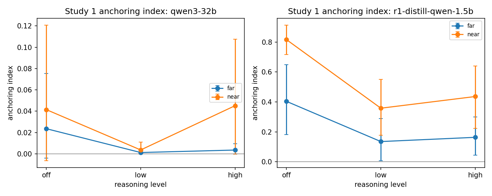
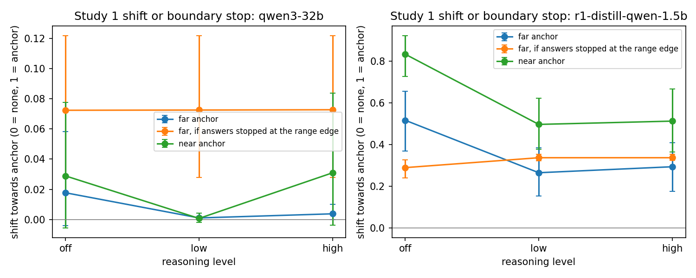
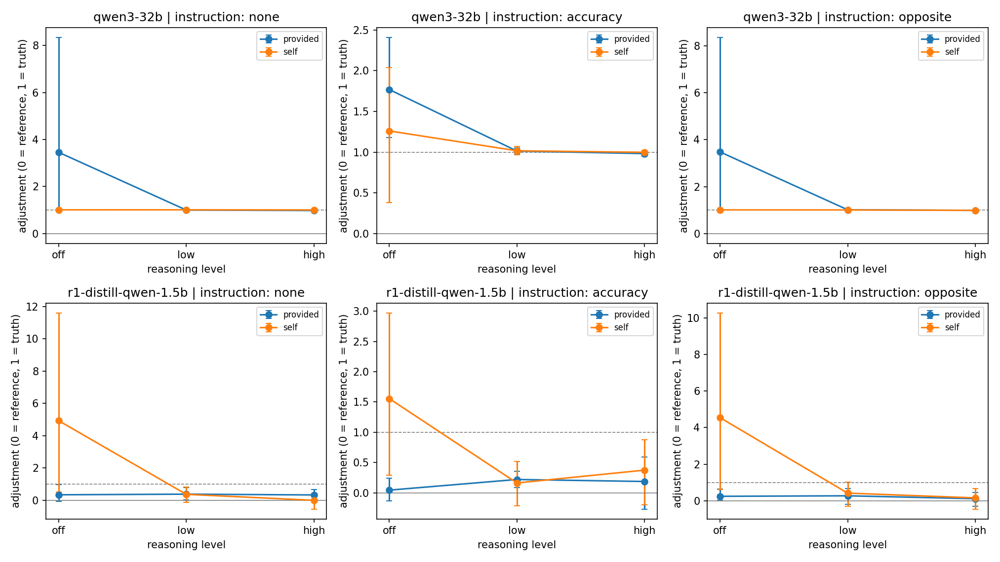
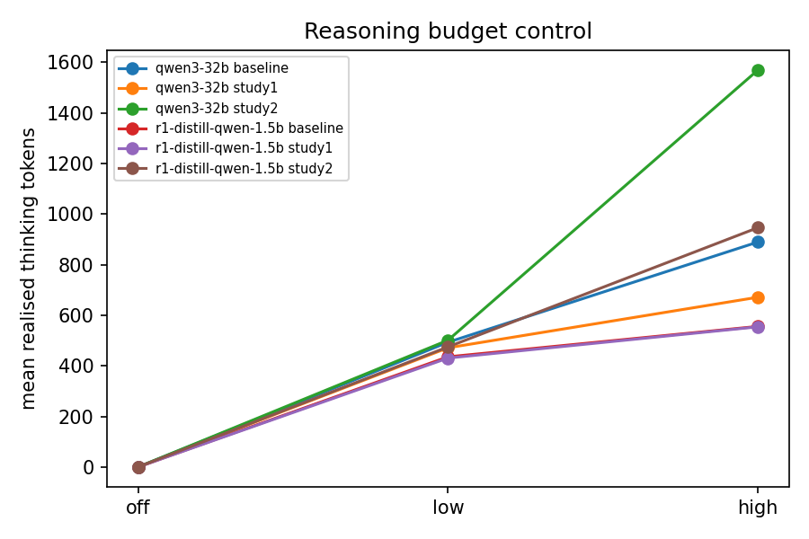

# Pilot results

Generated by `anchoring_llms.analysis`. All numbers are averaged over items; brackets are 95% bootstrap intervals over items.

## 1. Data quality

| study | model | thinking_level | answers | parse_rate | format_rate | mean_thinking_tokens | truncated_rate |
| --- | --- | --- | --- | --- | --- | --- | --- |
| baseline | qwen3-32b | off | 300 | 1.000 | 1.000 | 0.000 | 0.000 |
| baseline | qwen3-32b | low | 300 | 1.000 | 1.000 | 493.210 | 0.797 |
| baseline | qwen3-32b | high | 300 | 1.000 | 1.000 | 889.403 | 0.063 |
| baseline | r1-distill-qwen-1.5b | off | 300 | 0.913 | 0.000 | 0.000 | 0.000 |
| baseline | r1-distill-qwen-1.5b | low | 300 | 1.000 | 0.927 | 435.573 | 0.490 |
| baseline | r1-distill-qwen-1.5b | high | 300 | 1.000 | 0.943 | 555.803 | 0.010 |
| study1 | qwen3-32b | off | 1200 | 1.000 | 1.000 | 0.000 | 0.000 |
| study1 | qwen3-32b | low | 1200 | 1.000 | 1.000 | 471.197 | 0.604 |
| study1 | qwen3-32b | high | 1200 | 1.000 | 1.000 | 671.192 | 0.023 |
| study1 | r1-distill-qwen-1.5b | off | 1200 | 0.901 | 0.170 | 0.000 | 0.000 |
| study1 | r1-distill-qwen-1.5b | low | 1200 | 0.999 | 0.986 | 430.686 | 0.432 |
| study1 | r1-distill-qwen-1.5b | high | 1200 | 0.998 | 0.983 | 554.156 | 0.014 |
| study2 | qwen3-32b | off | 900 | 1.000 | 0.849 | 0.000 | 0.000 |
| study2 | qwen3-32b | low | 900 | 1.000 | 0.978 | 501.203 | 0.912 |
| study2 | qwen3-32b | high | 900 | 1.000 | 0.971 | 1569.150 | 0.546 |
| study2 | r1-distill-qwen-1.5b | off | 900 | 0.688 | 0.094 | 0.000 | 0.000 |
| study2 | r1-distill-qwen-1.5b | low | 900 | 1.000 | 0.981 | 474.906 | 0.667 |
| study2 | r1-distill-qwen-1.5b | high | 900 | 1.000 | 0.964 | 946.178 | 0.152 |

### Items to drop or replace

| model | item_id | status |
| --- | --- | --- |
| qwen3-32b | S1-02 | likely memorised (range 193-193) |
| qwen3-32b | S1-04 | likely memorised (range 316-316) |
| qwen3-32b | S1-06 | likely memorised (range 979-979) |
| qwen3-32b | S1-07 | likely memorised (range 1642-1642) |
| qwen3-32b | S1-09 | likely memorised (range 2228-2228) |
| qwen3-32b | S1-10 | likely memorised (range 3650-3650) |
| qwen3-32b | S1-11 | likely memorised (range 8300-8560.1) |
| qwen3-32b | S1-12 | likely memorised (range 9288-9288.05) |
| qwen3-32b | S1-13 | likely memorised (range 12000-12225.9) |

### Anchors left out

These anchors were zero or negative for a positive quantity, because the model's answers were spread over many orders of magnitude. Their answers are not analysed.

| model | item_id | direction | distance | precision | anchor | answers |
| --- | --- | --- | --- | --- | --- | --- |
| r1-distill-qwen-1.5b | S1-03 | low | far | precise | -1.000 | 30 |
| r1-distill-qwen-1.5b | S1-03 | low | far | round | 0.000 | 30 |
| r1-distill-qwen-1.5b | S1-05 | low | far | precise | -1.000 | 30 |
| r1-distill-qwen-1.5b | S1-05 | low | far | round | 0.000 | 30 |
| r1-distill-qwen-1.5b | S1-05 | low | near | precise | -1.000 | 30 |
| r1-distill-qwen-1.5b | S1-08 | low | far | precise | -1.000 | 30 |
| r1-distill-qwen-1.5b | S1-14 | low | far | precise | -1.000 | 30 |
| r1-distill-qwen-1.5b | S1-15 | low | far | precise | -1.000 | 30 |
| r1-distill-qwen-1.5b | S1-15 | low | far | round | 0.000 | 30 |
| r1-distill-qwen-1.5b | S1-15 | low | near | precise | -1.000 | 30 |
| r1-distill-qwen-1.5b | S1-15 | low | near | round | 0.000 | 30 |

## 2. Study 1: does anchoring appear?

Anchoring index (Jacowitz & Kahneman, 1995). Humans typically score 0.4-0.6.

| model | thinking_level | distance | mean | ci_low | ci_high | n_items |
| --- | --- | --- | --- | --- | --- | --- |
| qwen3-32b | off | far | 0.024 | -0.004 | 0.075 | 15 |
| qwen3-32b | off | near | 0.041 | -0.006 | 0.121 | 15 |
| qwen3-32b | low | far | 0.001 | 0.000 | 0.002 | 15 |
| qwen3-32b | low | near | 0.004 | -0.000 | 0.011 | 15 |
| qwen3-32b | high | far | 0.003 | 0.000 | 0.009 | 15 |
| qwen3-32b | high | near | 0.045 | -0.000 | 0.108 | 15 |
| r1-distill-qwen-1.5b | off | far | 0.404 | 0.182 | 0.648 | 12 |
| r1-distill-qwen-1.5b | off | near | 0.816 | 0.717 | 0.913 | 14 |
| r1-distill-qwen-1.5b | low | far | 0.135 | 0.008 | 0.288 | 12 |
| r1-distill-qwen-1.5b | low | near | 0.358 | 0.178 | 0.551 | 14 |
| r1-distill-qwen-1.5b | high | far | 0.164 | 0.045 | 0.299 | 12 |
| r1-distill-qwen-1.5b | high | near | 0.436 | 0.222 | 0.641 | 14 |

## 3. Study 1: shift or boundary stopping?

Boundary score: 0 means the whole answer distribution shifts towards the anchor (selective accessibility); 1 means answers stop at the edge of the plausible range (insufficient adjustment).

Mean proportional shift towards the anchor (0 = none, 1 = answer equals anchor), and the far-anchor shift that boundary stopping would predict:

| model | thinking_level | shift_near | shift_far | boundary_pred_far | boundary_score |
| --- | --- | --- | --- | --- | --- |
| qwen3-32b | off | 0.029 | 0.018 | 0.072 | -0.257 |
| qwen3-32b | low | 0.001 | 0.001 | 0.073 | 0.005 |
| qwen3-32b | high | 0.031 | 0.004 | 0.073 | -0.650 |
| r1-distill-qwen-1.5b | off | 0.855 | 0.512 | 0.299 | 0.617 |
| r1-distill-qwen-1.5b | low | 0.481 | 0.235 | 0.330 | 1.629 |
| r1-distill-qwen-1.5b | high | 0.505 | 0.272 | 0.331 | 1.340 |

## 4. Study 1: precise vs round anchors

Positive values mean precise anchors pulled harder (the adjustment prediction).

| model | thinking_level | mean | ci_low | ci_high | n_items |
| --- | --- | --- | --- | --- | --- |
| qwen3-32b | off | -0.032 | -0.153 | 0.039 | 15 |
| qwen3-32b | low | -0.003 | -0.008 | 0.001 | 15 |
| qwen3-32b | high | 0.003 | -0.013 | 0.019 | 15 |
| r1-distill-qwen-1.5b | off | 0.098 | -0.031 | 0.211 | 15 |
| r1-distill-qwen-1.5b | low | 0.106 | 0.011 | 0.208 | 15 |
| r1-distill-qwen-1.5b | high | 0.121 | 0.040 | 0.200 | 15 |

## 5. Study 2: self-generated vs provided anchors

Adjustment: 0 = answer stayed at the reference value, 1 = reached the true value. The key prediction is that more reasoning increases adjustment for `self` but not `provided`.

| model | instruction | source | thinking_level | mean | ci_low | ci_high | n_items |
| --- | --- | --- | --- | --- | --- | --- | --- |
| qwen3-32b | accuracy | provided | off | 1.767 | 1.177 | 2.407 | 15 |
| qwen3-32b | accuracy | provided | low | 1.013 | 0.971 | 1.053 | 15 |
| qwen3-32b | accuracy | provided | high | 0.982 | 0.951 | 1.007 | 15 |
| qwen3-32b | accuracy | self | off | 1.260 | 0.378 | 2.036 | 15 |
| qwen3-32b | accuracy | self | low | 1.017 | 0.968 | 1.070 | 15 |
| qwen3-32b | accuracy | self | high | 0.998 | 0.967 | 1.020 | 15 |
| qwen3-32b | none | provided | off | 3.457 | 0.999 | 8.339 | 15 |
| qwen3-32b | none | provided | low | 1.003 | 0.968 | 1.046 | 15 |
| qwen3-32b | none | provided | high | 0.984 | 0.955 | 1.004 | 15 |
| qwen3-32b | none | self | off | 1.011 | 0.987 | 1.032 | 15 |
| qwen3-32b | none | self | low | 1.011 | 0.973 | 1.057 | 15 |
| qwen3-32b | none | self | high | 1.007 | 0.985 | 1.030 | 15 |
| qwen3-32b | opposite | provided | off | 3.476 | 1.016 | 8.349 | 15 |
| qwen3-32b | opposite | provided | low | 1.016 | 0.986 | 1.046 | 15 |
| qwen3-32b | opposite | provided | high | 0.991 | 0.973 | 1.006 | 15 |
| qwen3-32b | opposite | self | off | 1.010 | 0.980 | 1.048 | 15 |
| qwen3-32b | opposite | self | low | 1.009 | 0.974 | 1.046 | 15 |
| qwen3-32b | opposite | self | high | 0.990 | 0.962 | 1.018 | 15 |
| r1-distill-qwen-1.5b | accuracy | provided | off | 0.045 | -0.130 | 0.245 | 15 |
| r1-distill-qwen-1.5b | accuracy | provided | low | 0.220 | 0.084 | 0.354 | 15 |
| r1-distill-qwen-1.5b | accuracy | provided | high | 0.187 | -0.269 | 0.593 | 15 |
| r1-distill-qwen-1.5b | accuracy | self | off | 1.555 | 0.287 | 2.972 | 15 |
| r1-distill-qwen-1.5b | accuracy | self | low | 0.163 | -0.217 | 0.520 | 15 |
| r1-distill-qwen-1.5b | accuracy | self | high | 0.375 | -0.195 | 0.878 | 15 |
| r1-distill-qwen-1.5b | none | provided | off | 0.334 | -0.061 | 0.972 | 15 |
| r1-distill-qwen-1.5b | none | provided | low | 0.373 | 0.005 | 0.782 | 15 |
| r1-distill-qwen-1.5b | none | provided | high | 0.323 | 0.034 | 0.649 | 15 |
| r1-distill-qwen-1.5b | none | self | off | 4.923 | 0.517 | 11.600 | 13 |
| r1-distill-qwen-1.5b | none | self | low | 0.361 | -0.121 | 0.825 | 15 |
| r1-distill-qwen-1.5b | none | self | high | -0.009 | -0.553 | 0.410 | 15 |
| r1-distill-qwen-1.5b | opposite | provided | off | 0.243 | 0.021 | 0.637 | 15 |
| r1-distill-qwen-1.5b | opposite | provided | low | 0.271 | -0.187 | 0.667 | 15 |
| r1-distill-qwen-1.5b | opposite | provided | high | 0.114 | -0.305 | 0.453 | 15 |
| r1-distill-qwen-1.5b | opposite | self | off | 4.546 | 0.610 | 10.279 | 14 |
| r1-distill-qwen-1.5b | opposite | self | low | 0.417 | -0.292 | 1.031 | 15 |
| r1-distill-qwen-1.5b | opposite | self | high | 0.157 | -0.456 | 0.681 | 15 |

## 6. Reasoning traces (simple features)

| study | model | thinking_level | mentions_start | first_number_is_start | adjust_words | evidence_words |
| --- | --- | --- | --- | --- | --- | --- |
| study1 | qwen3-32b | low | 0.985 | 0.835 | 0.590 | 3.574 |
| study1 | qwen3-32b | high | 1.000 | 0.824 | 0.795 | 3.987 |
| study1 | r1-distill-qwen-1.5b | low | 0.857 | 0.470 | 0.457 | 3.391 |
| study1 | r1-distill-qwen-1.5b | high | 0.927 | 0.474 | 0.628 | 3.594 |
| study2 | qwen3-32b | low | 0.760 | 0.261 | 0.658 | 2.622 |
| study2 | qwen3-32b | high | 0.862 | 0.256 | 1.859 | 3.862 |
| study2 | r1-distill-qwen-1.5b | low | 0.826 | 0.274 | 1.131 | 2.858 |
| study2 | r1-distill-qwen-1.5b | high | 0.858 | 0.267 | 1.774 | 3.592 |

A stratified sample for hand coding is in `hand_coding_sample.csv`.

## Figures

