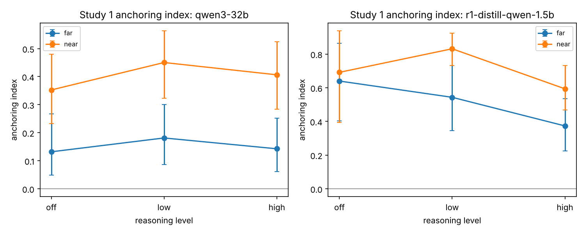
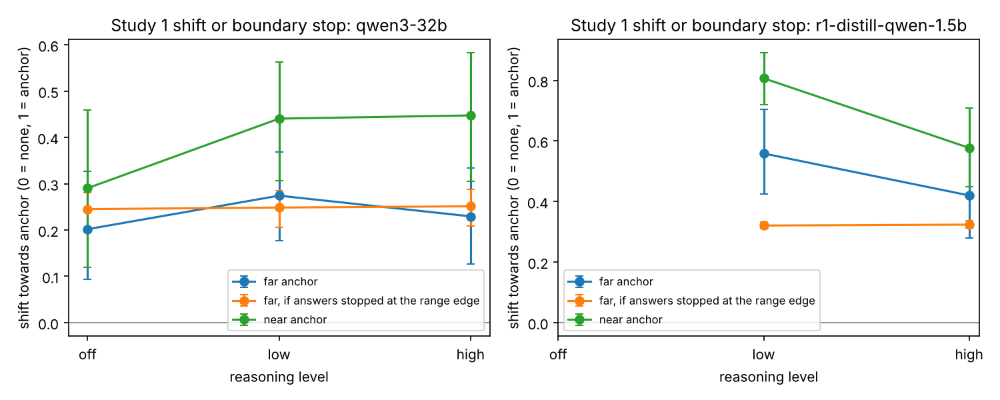
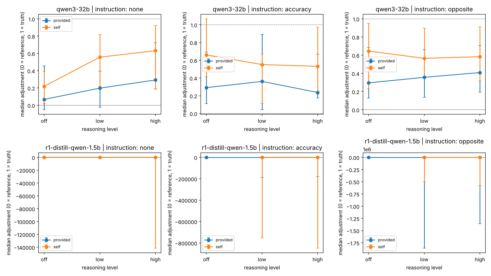
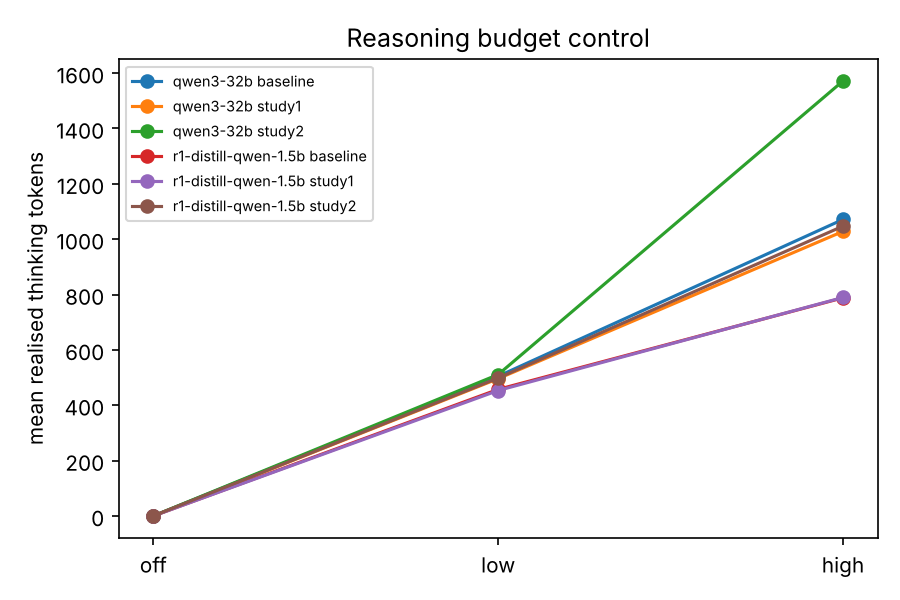

# Pilot results

Generated by `anchoring_llms.analysis`. All numbers are averaged over items; brackets are 95% bootstrap intervals over items.

## 1. Data quality

| study | model | thinking_level | answers | parse_rate | format_rate | mean_thinking_tokens | truncated_rate | answer_cut_off_rate |
| --- | --- | --- | --- | --- | --- | --- | --- | --- |
| baseline | qwen3-32b | off | 300 | 1.000 | 1.000 | 0.000 | 0.000 | 0.000 |
| baseline | qwen3-32b | low | 300 | 1.000 | 1.000 | 504.750 | 0.893 | 0.000 |
| baseline | qwen3-32b | high | 300 | 1.000 | 1.000 | 1071.387 | 0.207 | 0.000 |
| baseline | r1-distill-qwen-1.5b | off | 300 | 0.000 | 0.000 | 0.000 | 0.000 | 0.000 |
| baseline | r1-distill-qwen-1.5b | low | 300 | 0.967 | 0.967 | 457.423 | 0.547 | 0.007 |
| baseline | r1-distill-qwen-1.5b | high | 300 | 0.957 | 0.957 | 788.093 | 0.167 | 0.003 |
| study1 | qwen3-32b | off | 1200 | 1.000 | 1.000 | 0.000 | 0.000 | 0.000 |
| study1 | qwen3-32b | low | 1200 | 1.000 | 1.000 | 496.099 | 0.808 | 0.000 |
| study1 | qwen3-32b | high | 1200 | 1.000 | 1.000 | 1028.155 | 0.223 | 0.001 |
| study1 | r1-distill-qwen-1.5b | off | 1180 | 0.092 | 0.092 | 0.000 | 0.000 | 0.000 |
| study1 | r1-distill-qwen-1.5b | low | 1180 | 0.992 | 0.992 | 453.287 | 0.523 | 0.003 |
| study1 | r1-distill-qwen-1.5b | high | 1180 | 0.988 | 0.988 | 789.514 | 0.135 | 0.002 |
| study2 | qwen3-32b | off | 600 | 0.998 | 0.998 | 0.000 | 0.000 | 0.002 |
| study2 | qwen3-32b | low | 600 | 1.000 | 1.000 | 510.948 | 0.983 | 0.002 |
| study2 | qwen3-32b | high | 600 | 1.000 | 1.000 | 1571.672 | 0.455 | 0.000 |
| study2 | r1-distill-qwen-1.5b | off | 600 | 0.028 | 0.028 | 0.000 | 0.000 | 0.000 |
| study2 | r1-distill-qwen-1.5b | low | 600 | 0.993 | 0.993 | 498.475 | 0.863 | 0.003 |
| study2 | r1-distill-qwen-1.5b | high | 600 | 0.980 | 0.980 | 1047.178 | 0.137 | 0.003 |

### Items to drop or replace

None flagged.

## 2. Study 1: does anchoring appear?

Anchoring index (Jacowitz & Kahneman, 1995). Humans typically score 0.4-0.6.

| model | thinking_level | distance | mean | ci_low | ci_high | n_items |
| --- | --- | --- | --- | --- | --- | --- |
| qwen3-32b | off | far | 0.132 | 0.049 | 0.267 | 15 |
| qwen3-32b | off | near | 0.352 | 0.233 | 0.479 | 15 |
| qwen3-32b | low | far | 0.181 | 0.086 | 0.300 | 15 |
| qwen3-32b | low | near | 0.450 | 0.322 | 0.563 | 15 |
| qwen3-32b | high | far | 0.143 | 0.061 | 0.252 | 15 |
| qwen3-32b | high | near | 0.406 | 0.284 | 0.525 | 15 |
| r1-distill-qwen-1.5b | off | far | 0.640 | 0.404 | 0.864 | 8 |
| r1-distill-qwen-1.5b | off | near | 0.691 | 0.394 | 0.937 | 6 |
| r1-distill-qwen-1.5b | low | far | 0.543 | 0.346 | 0.733 | 14 |
| r1-distill-qwen-1.5b | low | near | 0.831 | 0.732 | 0.925 | 15 |
| r1-distill-qwen-1.5b | high | far | 0.373 | 0.225 | 0.535 | 14 |
| r1-distill-qwen-1.5b | high | near | 0.594 | 0.468 | 0.732 | 15 |

## 3. Study 1: shift or boundary stopping?

Boundary score: 0 means the whole answer distribution shifts towards the anchor (selective accessibility); 1 means answers stop at the edge of the plausible range (insufficient adjustment).

Mean proportional shift towards the anchor (0 = none, 1 = answer equals anchor), and the far-anchor shift that boundary stopping would predict:

| model | thinking_level | shift_near | shift_far | boundary_pred_far | boundary_score |
| --- | --- | --- | --- | --- | --- |
| qwen3-32b | off | 0.290 | 0.202 | 0.245 | 1.959 |
| qwen3-32b | low | 0.441 | 0.274 | 0.249 | 0.866 |
| qwen3-32b | high | 0.447 | 0.229 | 0.251 | 1.111 |
| r1-distill-qwen-1.5b | low | 0.811 | 0.559 | 0.319 | 0.513 |
| r1-distill-qwen-1.5b | high | 0.570 | 0.408 | 0.321 | 0.651 |

## 4. Study 1: precise vs round anchors

Positive values mean precise anchors pulled harder (the adjustment prediction).

| model | thinking_level | mean | ci_low | ci_high | n_items |
| --- | --- | --- | --- | --- | --- |
| qwen3-32b | off | -0.086 | -0.201 | 0.021 | 15 |
| qwen3-32b | low | -0.022 | -0.072 | 0.034 | 15 |
| qwen3-32b | high | -0.035 | -0.111 | 0.042 | 15 |
| r1-distill-qwen-1.5b | low | 0.096 | 0.009 | 0.187 | 15 |
| r1-distill-qwen-1.5b | high | 0.068 | 0.011 | 0.131 | 15 |

## 5. Study 2: self-generated vs provided anchors

Adjustment: 0 = answer stayed at the reference value, 1 = reached the true value. The key prediction is that more reasoning increases adjustment for `self` but not `provided`. The column `mean` here is the **median over questions** (with a bootstrap interval), so a few wrong answers cannot dominate it.

| model | instruction | source | thinking_level | mean | ci_low | ci_high | n_items |
| --- | --- | --- | --- | --- | --- | --- | --- |
| qwen3-32b | accuracy | provided | off | 0.292 | 0.112 | 0.693 | 10 |
| qwen3-32b | accuracy | provided | low | 0.362 | 0.042 | 0.892 | 10 |
| qwen3-32b | accuracy | provided | high | 0.237 | 0.175 | 0.669 | 10 |
| qwen3-32b | accuracy | self | off | 0.661 | 0.414 | 1.067 | 10 |
| qwen3-32b | accuracy | self | low | 0.552 | 0.114 | 0.672 | 10 |
| qwen3-32b | accuracy | self | high | 0.532 | 0.219 | 0.975 | 10 |
| qwen3-32b | none | provided | off | 0.068 | -0.052 | 0.457 | 10 |
| qwen3-32b | none | provided | low | 0.198 | -0.023 | 0.395 | 10 |
| qwen3-32b | none | provided | high | 0.293 | 0.186 | 0.722 | 10 |
| qwen3-32b | none | self | off | 0.219 | 0.021 | 0.395 | 10 |
| qwen3-32b | none | self | low | 0.557 | 0.217 | 0.817 | 10 |
| qwen3-32b | none | self | high | 0.632 | 0.190 | 0.925 | 10 |
| qwen3-32b | opposite | provided | off | 0.296 | 0.129 | 0.686 | 10 |
| qwen3-32b | opposite | provided | low | 0.357 | 0.136 | 0.662 | 10 |
| qwen3-32b | opposite | provided | high | 0.409 | 0.193 | 0.706 | 10 |
| qwen3-32b | opposite | self | off | 0.646 | 0.230 | 0.949 | 10 |
| qwen3-32b | opposite | self | low | 0.566 | 0.349 | 0.900 | 10 |
| qwen3-32b | opposite | self | high | 0.584 | 0.317 | 0.911 | 10 |
| r1-distill-qwen-1.5b | accuracy | provided | off | -0.027 | -0.054 | 0.000 | 2 |
| r1-distill-qwen-1.5b | accuracy | provided | low | 0.000 | -188475.774 | 0.457 | 10 |
| r1-distill-qwen-1.5b | accuracy | provided | high | 0.008 | -179595.747 | 0.464 | 10 |
| r1-distill-qwen-1.5b | accuracy | self | low | -0.043 | -754308.432 | 1.658 | 10 |
| r1-distill-qwen-1.5b | accuracy | self | high | 0.255 | -849376.545 | 2.844 | 10 |
| r1-distill-qwen-1.5b | none | provided | off | 0.074 | -0.006 | 3.487 | 5 |
| r1-distill-qwen-1.5b | none | provided | low | -0.004 | -0.237 | 1.003 | 10 |
| r1-distill-qwen-1.5b | none | provided | high | 0.000 | -0.002 | 1.814 | 10 |
| r1-distill-qwen-1.5b | none | self | off | 0.047 | -0.840 | 0.934 | 2 |
| r1-distill-qwen-1.5b | none | self | low | 0.084 | -0.007 | 2.581 | 10 |
| r1-distill-qwen-1.5b | none | self | high | 0.449 | -141561.382 | 1.884 | 10 |
| r1-distill-qwen-1.5b | opposite | provided | off | -0.209 | -0.419 | 0.000 | 2 |
| r1-distill-qwen-1.5b | opposite | provided | low | -0.051 | -1859911.885 | 0.007 | 10 |
| r1-distill-qwen-1.5b | opposite | provided | high | -0.021 | -1359001.512 | 0.366 | 10 |
| r1-distill-qwen-1.5b | opposite | self | low | -0.033 | -502871.626 | 0.099 | 10 |
| r1-distill-qwen-1.5b | opposite | self | high | 0.349 | -574710.688 | 11.486 | 10 |

## 6. Reasoning traces (simple features)

| study | model | thinking_level | mentions_start | first_number_is_start | adjust_words | evidence_words |
| --- | --- | --- | --- | --- | --- | --- |
| study1 | qwen3-32b | low | 0.817 | 0.691 | 0.400 | 3.163 |
| study1 | qwen3-32b | high | 0.902 | 0.689 | 1.067 | 3.867 |
| study1 | r1-distill-qwen-1.5b | low | 0.746 | 0.404 | 0.448 | 3.232 |
| study1 | r1-distill-qwen-1.5b | high | 0.915 | 0.395 | 0.718 | 3.403 |
| study2 | qwen3-32b | low | 0.573 | 0.017 | 0.687 | 2.363 |
| study2 | qwen3-32b | high | 0.743 | 0.020 | 2.455 | 5.550 |
| study2 | r1-distill-qwen-1.5b | low | 0.650 | 0.002 | 0.423 | 3.050 |
| study2 | r1-distill-qwen-1.5b | high | 0.690 | 0.003 | 0.775 | 4.078 |

A stratified sample for hand coding is in `hand_coding_sample.csv`.

## Figures

